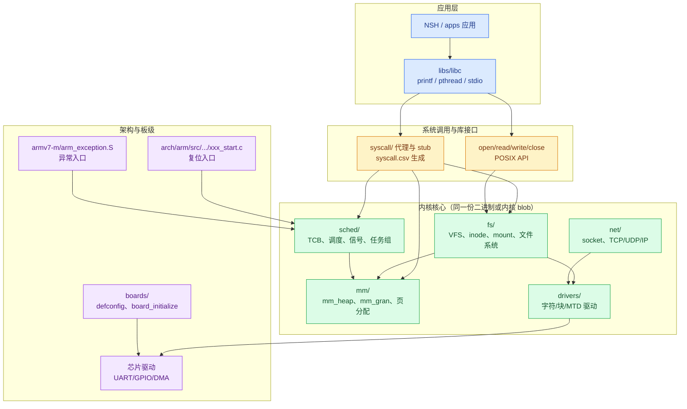
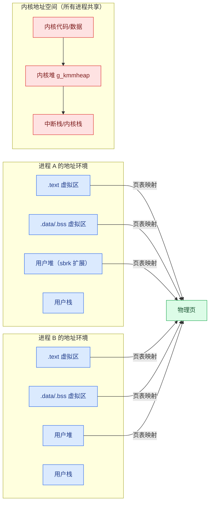
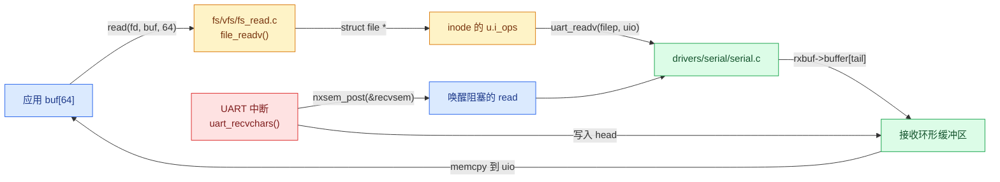

# NuttX 源码详解 00：总览与架构

> 涉及文件（本仓库绝对路径）：
> - `sched/init/nx_start.c`（772 行）：内核总初始化入口
> - `sched/sched/sched_switchcontext.c`（100 行）：上下文切换的公共逻辑
> - `sched/task/task_create.c`（300 行）、`sched/task/task_setup.c`（764 行）：任务创建
> - `fs/vfs/fs_open.c`（492 行）、`fs/inode/fs_files.c`（982 行）：VFS 与 fd 表
> - `mm/mm_heap/mm_malloc.c`（413 行）、`mm/mm_gran/mm_graninit.c`（159 行）：两级内存分配
> - `include/nuttx/sched.h`（TCB、task_group_s 定义）
> - `include/nuttx/fs/fs.h`（inode、file、file_operations 定义）
> - `Kconfig` 第 309-346 行：FLAT / PROTECTED / KERNEL 三种构建模式
>
> **版本基线说明**：本仓库没有 `include/nuttx/version.h`，也没有 `.version` 文件，
> 该头文件由构建系统调用 `tools/version.sh` 现场生成；`git describe` 只得到
> `orig-1-gdfac26a2`。因此本文不写死版本号，行号一律以当前工作区
> （提交 `dfac26a2`）为准。仓库包含 `sched/`、`fs/`、`mm/`、`drivers/`、`arch/arm/src/`
> 等完整内核目录，`arch/arm/src/stm32f4` 是裁剪过的子集，本文涉及 ARM 启动链时统一用
> `arch/arm/src/stm32h7` 这个完整目标举例。

---

## 1. 先用一句话定位

**NuttX 是一个"按 POSIX 进程/线程语义组织、但可以在 8 位 MCU 上跑"的 RTOS。**
它的核心不是"像 Linux 一样提供完整的虚拟内存"，而是：

- 调度单位是 **TCB（task control block）**，不是 Linux 的 `task_struct`；
- 资源归属单位是 **task group**，不是 Linux 的 `mm_struct + files_struct`；
- 文件系统是 **挂载在伪文件系统树上的 VFS**，设备也是树上的 inode；
- 中断上半段在 `arch/`，下半段常用 **work queue** 或驱动自己的内核线程。

这三点决定了后面所有模块的形态。

## 2. 代码地图

| 目录 | 行数量级 | 职责 | 本文档对应 |
|---|---:|---|---|
| `sched/` | 约 6 万行 | 任务、调度、信号、信号量、消息队列、定时器、任务组 | 01/02/03/05 |
| `fs/` | 约 8 万行 | VFS、inode、mount、各文件系统、mmap、AIO | 06 |
| `mm/` | 约 2 万行 | `mm_heap` 通用堆、`mm_gran` 颗粒分配、`kmm/umm` 内核/用户堆、`map` 虚拟映射 | 04 |
| `drivers/` | 约 15 万行 | 字符/块/MTD 驱动、串口、I2C/SPI、USB、网络芯片 | 07 |
| `net/` | 约 10 万行 | BSD socket 层、TCP/UDP/IP、netdev | 00 提及 |
| `libs/libc/` | 约 8 万行 | libc、stdio、pthread 的用户侧封装 | 00/06 |
| `arch/arm/src/` | 最大 | Cortex-M/A/R 的启动、异常、上下文、芯片驱动 | 01/07 |
| `boards/` | 板级 | 具体板子的 `defconfig`、引脚、初始化 | 07 |
| `syscall/` | 生成器 | `syscall.csv` 是系统调用总表，生成代理/stub | 00/03 |
| `include/nuttx/` | 头文件 | TCB、inode、file_operations、init 状态机 | 全部 |

> 读码顺序建议：`include/nuttx/sched.h` → `sched/init/nx_start.c` →
> `sched/task/task_create.c` → `sched/sched/sched_addreadytorun.c` →
> `fs/vfs/fs_open.c` → `mm/mm_heap/mm_malloc.c`。不要从 `net/` 或 `drivers/` 开头。

## 3. 分层架构

NuttX 的分层不是"微内核式服务进程"，而是**同一地址空间内的库化内核**（FLAT 模式）
或**MPU/MMU 保护的内核 blob + 用户 blob**（PROTECTED/KERNEL 模式）。层与层之间是
直接函数调用，系统调用只在后两种模式出现。



### 3.1 为什么没有"服务进程"

NuttX 的内核服务（VFS、堆、调度）都是**链接进同一个镜像的函数**。
`open()` 在 FLAT 模式下就是普通函数调用；在 PROTECTED/KERNEL 模式下，
`syscall/syscall.csv` 会为它生成一个 SVC 代理，用户态执行 `svc` 陷入内核，
内核再调用同名实现。这样同一套源码可以编译出三种形态。

## 4. 三种构建模式

`Kconfig` 第 309-346 行定义了三种模式，这是理解 NuttX 地址空间的入口：

| 模式 | 配置 | 硬件要求 | 地址空间 | 系统调用 | 典型用途 |
|---|---|---|---|---|---|
| FLAT | `CONFIG_BUILD_FLAT` | 无 MPU/MMU | 全部代码/数据同一地址空间 | 无，直接调用 | Cortex-M0/M3 小系统 |
| PROTECTED | `CONFIG_BUILD_PROTECTED` | MPU | 内核 blob + 用户 blob，两个特权级 | 有 SVC 代理 | Cortex-M3/M4/M7 |
| KERNEL | `CONFIG_BUILD_KERNEL` | MMU + `ARCH_ADDRENV` | 每个进程独立地址环境 | 有 SVC 代理 | Cortex-A/R、带 MMU 的芯片 |

关键差异不在调度器，而在**资源归属**：

- FLAT：全局只有一份用户堆 `g_mmheap`（`include/nuttx/mm/mm.h:254`）；
- PROTECTED：内核堆 + 一份用户堆，用户堆结构放在用户空间；
- KERNEL：每个 task group 一个用户堆，堆结构放在该进程地址环境的保留页里
  （`mm/umm_heap/umm_initialize.c:68-76` 的注释说得很明确）。

## 5. 任务模型：TCB 是唯一调度实体

`struct tcb_s` 定义在 `include/nuttx/sched.h:583`，核心字段：

| 字段 | 行号 | 含义 | 读码要点 |
|---|---:|---|---|
| `flink` / `blink` | 587-588 | 双向链表钩子 | 同一 TCB 可能同时挂在就绪/阻塞/等待队列上 |
| `group` | 592 | 所属 task group | 线程共享资源都从这里找 |
| `pid` | 618 | 线程 ID | 不是 Linux 的进程 ID；组 ID 在 `group->tg_pid` |
| `sched_priority` | 619 | 当前优先级 | 数值越大越高 |
| `task_state` | 625 | 状态枚举 | 与 `g_tasklisttable` 一一对应 |
| `flags` | 637 | 类型/策略/状态位 | `TCB_FLAG_TTYPE_*`、`TCB_FLAG_SCHED_*` |
| `lockcount` | 638 | 抢占锁计数 | `sched_lock()` 加减的就是它 |
| `timeslice` | 645 | RR 时间片 / sporadic 预算 | 只有策略相关时才有效 |
| `adj_stack_size` | 660 | 调整后的栈大小 | 栈向下增长，实际可用量要减去上下文帧 |
| `xcp` | 745 | 寄存器保存区 | 上下文切换就是换这个结构 |

**任务与线程的区别只在 `flags` 的低两位**：

- `TCB_FLAG_TTYPE_TASK`：有独立 task group（独立 fd 表、环境变量、地址环境）；
- `TCB_FLAG_TTYPE_PTHREAD`：与创建者共享 task group；
- `TCB_FLAG_TTYPE_KERNEL`：内核线程，共享全局 `g_kthread_group`。

## 6. 地址空间模型

### 6.1 FLAT：没有"地址空间"这个概念

所有 TCB 的 `addrenv_own` 都是 `NULL`，`up_addrenv_select()` 不会被调用。
"进程隔离"不存在，只有栈是每个任务私有的。

### 6.2 PROTECTED：MPU 划分内核/用户

内核 blob 在 MPU 的 privileged region，用户 blob 在 unprivileged region。
用户态不能直接访问内核数据，必须走 SVC。任务组仍共享同一套物理地址，
但用户堆和内核堆是分开的。

### 6.3 KERNEL：每个 task group 一份地址环境

`struct addrenv_s`（`include/nuttx/addrenv.h:268`）只有一个
`arch_addrenv_s`（页目录）、一个延迟释放的 work、一个引用计数：

```c
struct addrenv_s
{
  struct arch_addrenv_s addrenv; /* The address environment page directory  */
  struct work_s         work;    /* Worker to free address environment      */
  atomic_t              refs;    /* Users of address environment            */
};
```

`addrenv_join()` 让新线程共享父进程的地址环境（`sched/addrenv/addrenv.c:273`），
`addrenv_fork()` 则复制页表（没有 COW，见该函数 304-316 行的注释），
`addrenv_leave()` 在退出时递减引用并释放。



## 7. 与 Linux/FreeRTOS 的对比

| 维度 | NuttX | Linux | FreeRTOS |
|---|---|---|---|
| 调度实体 | TCB | `task_struct` | TCB |
| 资源组 | task group（fd/环境/地址环境） | `mm_struct` + `files_struct` + `signal_struct` | 无，任务各自持有 |
| 默认调度 | FIFO 优先级 + 可选 RR/sporadic | CFS + 实时类 | 固定优先级抢占 + 可选时间片 |
| 优先级方向 | 数值越大越高 | 实时类数值越大越高，CFS 用权重 | 数值越大越高 |
| 地址空间 | FLAT/PROTECTED/KERNEL 三档 | 每进程独立 | 全部 FLAT |
| 系统调用 | 仅 PROTECTED/KERNEL 有 | 始终有 | 无 |
| 文件系统 | 内置 VFS + 可挂载 FS | VFS + 大量 FS | 通常无，靠组件 |
| 中断下半段 | work queue / 驱动线程 | softirq/tasklet/workqueue | 任务或守护任务 |
| 代码规模 | 约 100 万行 | 约 3000 万行 | 约 1 万行 |
| 典型 RAM | 几十 KB 起 | MB 起 | 几 KB 起 |

**一句话记忆**：NuttX 想给你 Linux 的**编程接口**，但只给你 FreeRTOS 级别的**资源模型**；
它用 task group 把"进程该有的东西"打包，用三种构建模式决定打不打包得动。

## 8. 一条数据流：从 `read()` 到 UART

以 FLAT 模式读串口为例，数据载体和函数链如下：



这条链上每一层都有独立的缓冲区/引用计数，读的时候要同时看
`filep->f_refs`、`inode->i_crefs` 和驱动自己的 `open_count`，否则很容易
在 close 竞态上判断错。

## 9. 读码路线

1. **启动**：`Docs/01` → `arch/arm/src/stm32h7/stm32_start.c` → `nx_start()`；
2. **调度**：`Docs/02` → `sched/sched/sched.h` 的 `nxsched_add_prioritized()`；
3. **任务组**：`Docs/03` → `include/nuttx/sched.h` 的 `task_group_s`；
4. **内存**：`Docs/04` → `mm/mm_heap/mm_malloc.c` 与 `mm/mm_gran/mm_grantable.c`；
5. **信号**：`Docs/05` → `sched/signal/sig_dispatch.c`；
6. **文件系统**：`Docs/06` → `fs/vfs/fs_open.c` + `fs/inode/fs_files.c`；
7. **驱动**：`Docs/07` → `drivers/serial/serial.c` + `serial_io.c`。

对应的 KB 条目（含逐函数表与真实行号摘录）：

| 主题 | KB 条目 |
|---|---|
| 启动 | [nx_start.md](../../../05-学习笔记与知识库/Knowledge-Base/nuttx/nx_start.md) |
| 调度 | [nxsched.md](../../../05-学习笔记与知识库/Knowledge-Base/nuttx/nxsched.md) |
| 任务创建 | [task_create.md](../../../05-学习笔记与知识库/Knowledge-Base/nuttx/task_create.md) |
| 任务退出 | [task_exit.md](../../../05-学习笔记与知识库/Knowledge-Base/nuttx/task_exit.md) |
| 通用堆 | [mm_heap.md](../../../05-学习笔记与知识库/Knowledge-Base/nuttx/mm_heap.md) |
| 颗粒分配 | [mm_gran.md](../../../05-学习笔记与知识库/Knowledge-Base/nuttx/mm_gran.md) |
| 信号 | [signal.md](../../../05-学习笔记与知识库/Knowledge-Base/nuttx/signal.md) |
| VFS | [vfs.md](../../../05-学习笔记与知识库/Knowledge-Base/nuttx/vfs.md) |
| ARM 启动 | [arm_start.md](../../../05-学习笔记与知识库/Knowledge-Base/nuttx/arm_start.md) |

## 10. 陷阱与实测建议

- **不要把 `pid` 当进程 ID**：NuttX 的 `pid` 是线程 ID，`getpid()` 返回的是
  `group->tg_pid`，两者在 pthread 场景下不同。
- **不要假设 `CONFIG_BUILD_FLAT`**：很多驱动代码用 `#ifdef CONFIG_BUILD_KERNEL`
  分支，读驱动前先看 defconfig。
- **`kmm_*` 与 `umm_*` 不是同一堆**：`kmm_malloc` 走 `g_kmmheap`，
  `malloc` 走 `USR_HEAP`；在 KERNEL 模式下两者完全隔离。
- **行号会随配置漂移**：本文所有行号基于默认源码树，不含 Kconfig 条件编译展开；
  用 `grep -n` 复核。
- **实测建议**：在 `nucleo-h743zi:nsh` 配置下打开 `CONFIG_DEBUG_MM` 与
  `CONFIG_SCHED_CRITMONITOR`，可以同时观察堆和调度延迟；串口波特率先确认
  `CONFIG_115200` 与实际晶振匹配，否则 `showprogress('A')` 都看不到。
