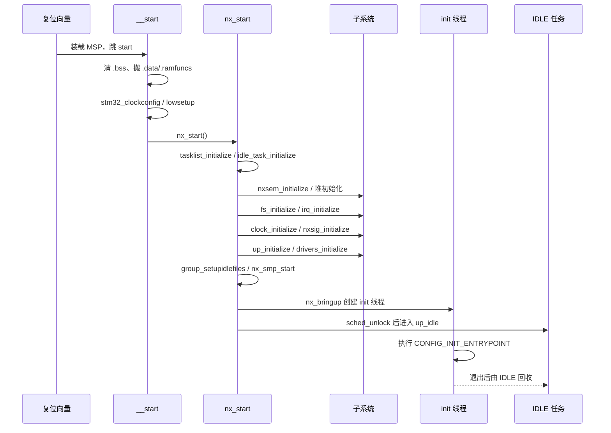
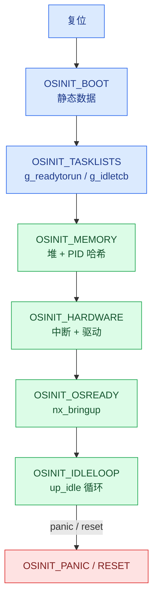
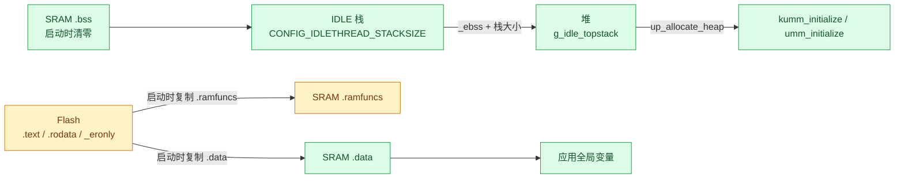

# NuttX 源码详解 01：启动流程与初始化链

> 涉及文件（本仓库绝对路径）：
> - `arch/arm/src/stm32h7/stm32_start.c`（320 行）：STM32H7 的复位 C 入口 `__start()`
> - `arch/arm/src/armv7-m/arm_vectors.c`（107 行）：Cortex-M 向量表
> - `arch/arm/src/armv7-m/arm_exception.S`（267 行）：异常公共入口 `exception_common`
> - `arch/arm/src/armv7-m/arm_doirq.c`（133 行）：中断分发与返回上下文
> - `arch/arm/src/common/arm_initialize.c`（121 行）：`up_initialize()`
> - `arch/arm/src/armv7-m/arm_initialstate.c`（208 行）：为任务构造初始寄存器帧
> - `sched/init/nx_start.c`（772 行）：OS 总初始化
> - `sched/init/nx_bringup.c`（约 540 行）：创建 worker 与 init 线程
> - `include/nuttx/init.h`：`g_nx_initstate` 状态枚举
> - `boards/arm/stm32h7/nucleo-h743zi/configs/nsh/defconfig`：板级配置样例
>
> 本文以 `stm32h7 + Cortex-M7 + CONFIG_BUILD_FLAT` 为主线；
> PROTECTED/KERNEL 的差异在 5.3 单独说明。

---

## 1. 启动链全景：从复位向量到第一个用户线程

Cortex-M 的复位行为是硬件固定的：从地址 `0x0000_0000` 取初始 MSP，
从 `0x0000_0004` 取复位向量。NuttX 把这两个值放在 `.vectors` 段里：

```c
const void * const _vectors[] locate_data(".vectors")
                              aligned_data(VECTAB_ALIGN) =
{
  /* Initial stack */

  IDLE_STACK,

  /* Reset exception handler */

  start,

  /* Vectors 2 - n point directly at the generic handler */

  [2 ... NVIC_IRQ_PENDSV] = &exception_common,
  [(NVIC_IRQ_PENDSV + 1) ... (15 + ARMV7M_PERIPHERAL_INTERRUPTS)]
                          = &exception_direct
};
```

（`arch/arm/src/armv7-m/arm_vectors.c:91-107`）

注意 `start` 不是 `__start` 本身，而是一个 4 条指令的跳板：

```c
static void start(void)
{
  /* Zero lr to mark the end of backtrace */

  asm volatile ("mov lr, #0\n\t"
                "b  __start\n\t");
}
```

（`arch/arm/src/armv7-m/arm_vectors.c:61-67`）

清 `lr` 的目的是让 backtrace 在 `__start` 处停止，而不是继续回溯到垃圾地址。
这是 NuttX 启动代码里一个很小但很实用的约定。

### 1.1 七个阶段

| 阶段 | 代码位置 | 关键动作 | 此时什么可用 |
|---|---|---|---|
| 0. 复位 | `arm_vectors.c:96` | 装载 `IDLE_STACK` 到 MSP，跳 `start` | 只有 Flash/SRAM |
| 1. `__start` 前半 | `stm32_start.c:203-241` | 清 `.bss`、搬 `.data`、搬 RAMFUNC | 只有静态内存 |
| 2. 时钟/串口 | `stm32_start.c:247-263` | `stm32_clockconfig()`、`stm32_lowsetup()`、`stm32_boardinitialize()` | 串口可输出 |
| 3. `nx_start` 前段 | `nx_start.c:510-538` | 建任务链表、IDLE TCB、信号量 | 静态数据结构 |
| 4. 内存/文件系统 | `nx_start.c:611-648` | 堆、PID 哈希、`fs_initialize()`、`irq_initialize()` | 可 `malloc`、可注册驱动 |
| 5. 硬件/驱动 | `nx_start.c:676-696` | `up_initialize()`、`drivers_initialize()` | 中断、tick、设备节点 |
| 6. 多任务 | `nx_start.c:742-757` | `nx_bringup()`、`sched_unlock()` | 调度器开始工作 |
| 7. IDLE | `nx_start.c:761-771` | `for (;;) up_idle()` | 系统正常运行 |

## 2. `__start`：在 C 运行时之前手工建好 C 运行时

`__start` 的代码非常"反直觉"：它不能用 `memset`/`memcpy`，因为
`.data` 还没搬完、`.bss` 还没清零，任何全局变量都不可信。

```c
  /* Clear .bss.  We'll do this inline (vs. calling memset) just to be
   * certain that there are no issues with the state of global variables.
   */

  for (dest = (uint32_t *)_sbss; dest < (uint32_t *)_ebss; )
    {
      *dest++ = 0;
    }

  /* Move the initialized data section from his temporary holding spot in
   * FLASH into the correct place in SRAM.  The correct place in SRAM is
   * give by _sdata and _edata.  The temporary location is in FLASH at the
   * end of all of the other read-only data (.text, .rodata) at _eronly.
   */

  for (src = (const uint32_t *)_eronly,
       dest = (uint32_t *)_sdata; dest < (uint32_t *)_edata;
      )
    {
      *dest++ = *src++;
    }
```

（`arch/arm/src/stm32h7/stm32_start.c:205-225`）

顺序很重要：**先清 `.bss`，再搬 `.data`**。反过来的话，`.data` 的初值会被
后面的 `.bss` 清零覆盖（如果链接脚本把两者放得很近）。链接脚本保证
`_sbss <= _ebss <= _sdata <= _edata`，但代码不依赖这个顺序，而是各扫各的区间。

### 2.1 RAMFUNC：把函数搬进 SRAM 再执行

```c
#ifdef CONFIG_ARCH_RAMFUNCS
  for (src = (const uint32_t *)_framfuncs,
       dest = (uint32_t *)_sramfuncs; dest < (uint32_t *)_eramfuncs;
      )
    {
      *dest++ = *src++;
    }
#endif
```

（`stm32_start.c:234-241`）

这段必须在 `stm32_clockconfig()` 之前完成，因为时钟配置函数本身可能位于
`.ramfuncs`（例如要改 Flash 等待周期，或 H7 的某些时钟切换代码不能在 Flash 里跑）。
注释里专门写了 "This should be done before stm32_clockconfig()"。

### 2.2 板级初始化与缓存

```c
  /* Configure the UART so that we can get debug output as soon as possible */

  stm32_clockconfig();
  arm_fpuconfig();
  stm32_lowsetup();
  showprogress('A');

#ifdef CONFIG_ARCH_CHIP_STM32H7_CORTEXM7
  /* Enable/disable tightly coupled memories */

  stm32_tcmenable();
#endif

  /* Initialize onboard resources */

  stm32_boardinitialize();
  showprogress('B');

#ifdef CONFIG_ARCH_CHIP_STM32H7_CORTEXM7
  /* Enable I- and D-Caches */

  up_enable_icache();
  up_enable_dcache();
#endif
  showprogress('C');
```

（`stm32_start.c:247-271`）

`showprogress(c)` 在 `CONFIG_DEBUG_FEATURES` 下展开为 `arm_lowputc(c)`，
否则是空宏（`stm32_start.c:104-108`）。所以量产出问题时看不到 A/B/C/D/E，
不是代码没跑，而是调试输出被编译掉了。

## 3. `nx_start`：初始化状态机

`g_nx_initstate` 的取值定义在 `include/nuttx/init.h`：

| 值 | 名称 | 含义 |
|---:|---|---|
| 1 | `OSINIT_BOOT` | 基本启动完成，OS 服务与硬件都不可用 |
| 2 | `OSINIT_TASKLISTS` | 就绪/分配任务链表可用 |
| 3 | `OSINIT_MEMORY` | 内存管理器可用 |
| 4 | `OSINIT_HARDWARE` | MCU 硬件、定时器、驱动可用 |
| 5 | `OSINIT_OSREADY` | OS 完全初始化，多任务开始 |
| 6 | `OSINIT_IDLELOOP` | 进入 IDLE 循环 |
| 7 | `OSINIT_RESET` | 正在复位 |
| 8 | `OSINIT_PANIC` | 致命错误 |

这个枚举不是"日志标签"，而是**内核内部的可用性契约**。很多函数在
`g_nx_initstate < OSINIT_MEMORY` 时不能调用 `kmm_malloc`，在
`< OSINIT_HARDWARE` 时不能等中断。

### 3.1 前两个阶段：静态数据结构

```c
  g_nx_initstate = OSINIT_BOOT;
  sched_trace_mark("BOOT");

  /* Initialize task list table *********************************************/

  tasklist_initialize();

  /* Initialize the IDLE task TCB *******************************************/

  idle_task_initialize();

  /* Task lists are initialized */

  g_nx_initstate = OSINIT_TASKLISTS;
  sched_trace_mark("TASKLISTS");

  /* Initialize RTOS Data ***************************************************/

  drivers_early_initialize();

  sched_trace_begin();
```

（`sched/init/nx_start.c:510-530`）

`tasklist_initialize()`（`nx_start.c:226-318`）把 `TSTATE_*` 枚举映射到
具体的队列指针或结构体偏移；`idle_task_initialize()`（`nx_start.c:328-419`）
为每个 CPU 构造 `g_idletcb[i]`，并把它直接放到就绪队列头部。
此时还没有堆，所以这两个函数只能用静态数组 `g_idletcb[]`。

### 3.2 内存管理与 IDLE 组

```c
  /* IDLE Group Initialization **********************************************/

  idle_group_initialize();

  g_lastpid = CONFIG_SMP_NCPUS - 1;

  /* The memory manager is available */

  g_nx_initstate = OSINIT_MEMORY;
  sched_trace_mark("MEMORY");

  /* Initialize tasking data structures */

  task_initialize();

  /* Initialize the instrument function */

  instrument_initialize();

  /* Initialize the file system (needed to support device drivers) */

  fs_initialize();

  /* Initialize the interrupt handling subsystem (if included) */

  irq_initialize();

  /* Initialize the POSIX timer facility (if included in the link) */

  clock_initialize();

#ifndef CONFIG_DISABLE_POSIX_TIMERS
  timer_initialize();
#endif

  /* Initialize the signal facility (if in link) */

#ifndef CONFIG_DISABLE_ALL_SIGNALS
  nxsig_initialize();
#endif
```

（`nx_start.c:611-648`）

`idle_group_initialize()` 是第一个"真正需要堆"的动作：它调用
`group_allocate(tcb, tcb->flags)`（`nx_start.c:447-448`），而
`group_allocate()` 在非内核线程分支里会 `kmm_zalloc(sizeof(struct task_group_s))`
（`sched/group/group_create.c:206`）。所以 `g_nx_initstate` 在它之前就设成了
`OSINIT_MEMORY`，顺序不能颠倒。

### 3.3 硬件与驱动

```c
  up_initialize();

  /* Initialize common drivers */

  drivers_initialize();

#ifdef CONFIG_BOARD_EARLY_INITIALIZE
  /* Call the board-specific up_initialize() extension to support
   * early initialization of board-specific drivers and resources
   * that cannot wait until board_late_initialize.
   */

  boards_trace_begin();
  board_early_initialize();
  boards_trace_end();
#endif

  /* Hardware resources are now available */

  g_nx_initstate = OSINIT_HARDWARE;
  sched_trace_mark("HARDWARE");
```

（`nx_start.c:676-696`）

`up_initialize()` 在 ARM 上对应 `arch/arm/src/common/arm_initialize.c:62`：
它依次做中断栈重初始化、`arm_addregion()` 加额外堆、PM、DMA、串口、网络、
USB、L2 cache。`drivers_initialize()`（`drivers/drivers_initialize.c:117`）
则注册 `/dev/null`、`/dev/zero`、`/dev/random`、syslog 等公共设备。

### 3.4 从内核线程到用户线程

```c
  /* The OS is fully initialized and we are beginning multi-tasking */

  g_nx_initstate = OSINIT_OSREADY;
  sched_trace_mark("OSREADY");

  /* Create initial tasks and bring-up the system */

  DEBUGVERIFY(nx_bringup());

  /* Enter to idleloop */

  g_nx_initstate = OSINIT_IDLELOOP;
  sched_trace_mark("IDLELOOP");

  /* Let other threads have access to the memory manager */

  sched_trace_end();
  sched_unlock();
```

（`nx_start.c:742-757`）

`nx_bringup()`（`sched/init/nx_bringup.c:496`）依次：

1. 设置 `PWD`/`PATH`/`LD_LIBRARY_PATH` 初始环境；
2. `nx_pgworker()` 启动缺页 worker（仅 `CONFIG_LEGACY_PAGING`）；
3. `nx_workqueues()` 启动高/低优先级 work queue；
4. `nx_create_initthread()` 创建第一个用户初始化线程。

## 4. 启动时序图



## 5. 初始化状态与内存布局

### 5.1 状态迁移



### 5.2 启动期的内存布局

STM32H7 的布局在 `stm32_start.c:60-74` 的注释里写得很清楚：

```c
#define HEAP_BASE  ((uintptr_t)_ebss + CONFIG_IDLETHREAD_STACKSIZE)
```

IDLE 栈紧跟在 `.bss` 之后，堆从 IDLE 栈顶开始。也就是说：

| 区域 | 起点 | 大小 | 说明 |
|---|---|---|---|
| `.data` | `_sdata` | `_edata - _sdata` | 从 Flash `_eronly` 搬来 |
| `.bss` | `_sbss` | `_ebss - _sbss` | 启动时清零 |
| IDLE 栈 | `_ebss` | `CONFIG_IDLETHREAD_STACKSIZE` | 向下增长 |
| 堆 | `_ebss + CONFIG_IDLETHREAD_STACKSIZE` | 到 SRAM 末尾 | `g_idle_topstack` 指向堆底 |



### 5.3 PROTECTED/KERNEL 的差异

- `CONFIG_BUILD_PROTECTED`：`__start` 末尾会调用 `stm32_userspace()` 初始化用户
  `.data/.bss` 副本，然后 `nx_start()` 仍在特权态运行；创建用户任务时
  `up_task_start()` 通过 SVC 切到非特权态。
- `CONFIG_BUILD_KERNEL`：`nx_start()` 只建立内核；用户进程由 `init` 线程
  `exec` 加载，`addrenv_allocate()` 为每个进程建页目录，`umm_initialize()`
  在该进程的地址环境里初始化堆。
- 两条路径都要求 MPU/MMU，且 `arch/arm/src/armv7-m/arm_initialstate.c:153-155`
  会把新任务的 `EXC_RETURN` 设为 `EXC_RETURN_THREAD`、`CONTROL.NPRIV` 清 0，
  保证任务第一次被调度时从特权线程模式开始，再由启动跳板降权。

## 6. 第一个任务是怎么"跑起来"的

`nx_bringup()` 创建 init 线程时走的是标准 `kthread_create()` 路径：

1. `kmm_zalloc(sizeof(struct tcb_s))` 分配 TCB；
2. `nxtask_init()` 建 group、复制环境、复制 fd、分配栈；
3. `nxtask_setup_scheduler()` 调 `up_initial_state(tcb)` 伪造寄存器帧；
4. `nxtask_activate()` 把 TCB 插入就绪队列，必要时 `up_switch_context()`；
5. 调度器选中它后，`arm_doirq()` 返回时从 `tcb->xcp.regs` 恢复寄存器，
   PC 指向 `nxtask_start`（`arm_initialstate.c:110`）。

`up_initial_state()` 的关键几行：

```c
  /* Save the initial stack pointer */

  xcp->regs[REG_SP]      = (uint32_t)tcb->stack_base_ptr +
                                     tcb->adj_stack_size;

  /* Save the task entry point (stripping off the thumb bit) */

  xcp->regs[REG_PC]      = (uint32_t)tcb->start & ~1;

  /* Specify thumb mode */

  xcp->regs[REG_XPSR]    = ARMV7M_XPSR_T;
```

（`arch/arm/src/armv7-m/arm_initialstate.c:99-114`）

`REG_SP` 指向栈顶而不是栈底；`REG_PC` 去掉 bit0 是因为 Cortex-M 的 Thumb
地址最低位只作为状态位，真正的指令地址必须偶数对齐。

## 7. 陷阱与实测建议

- **`.bss` 清零必须在 `.data` 搬运之前**：否则初值被覆盖。改链接脚本时
  一定检查 `_sbss/_ebss` 与 `_sdata/_edata` 不重叠。
- **`showprogress` 可能被编译掉**：看不到启动字符时先查 `CONFIG_DEBUG_FEATURES`，
  不要怀疑时钟。
- **`nx_start()` 不返回**：末尾是 `for (;;) up_idle()`；如果在 `nx_start` 里
  加 `return`，行为未定义。
- **IDLE 栈不是普通任务栈**：它在 `.bss` 之后、堆之前，大小由
  `CONFIG_IDLETHREAD_STACKSIZE` 决定，不经过 `up_create_stack()`。
- **SMP 的 CPU0 特殊**：`idle_task_initialize()` 只给 CPU0 用链接脚本里的栈，
  CPU1..N 的 IDLE 栈由 `up_cpu_idlestack()` 动态分配（`nx_start.c:454-462`）。
- **实测**：在 `nucleo-h743zi:nsh` 上把 `CONFIG_IDLETHREAD_STACKSIZE` 调到
  2048 并打开 `CONFIG_DEBUG_MM`，可以观察 `HEAP_BASE` 随栈大小上移；
  用 `nm vmlinux | grep -E '_ebss|g_idle_topstack'` 核对实际地址。

## 8. 读码路径

`arm_vectors.c` → `stm32_start.c` → `nx_start.c` → `nx_bringup.c` →
`task_create.c` → `task_setup.c` → `arm_initialstate.c`。
配套 KB：[arm_start.md](../../../05-学习笔记与知识库/Knowledge-Base/nuttx/arm_start.md)、
[nx_start.md](../../../05-学习笔记与知识库/Knowledge-Base/nuttx/nx_start.md)。
