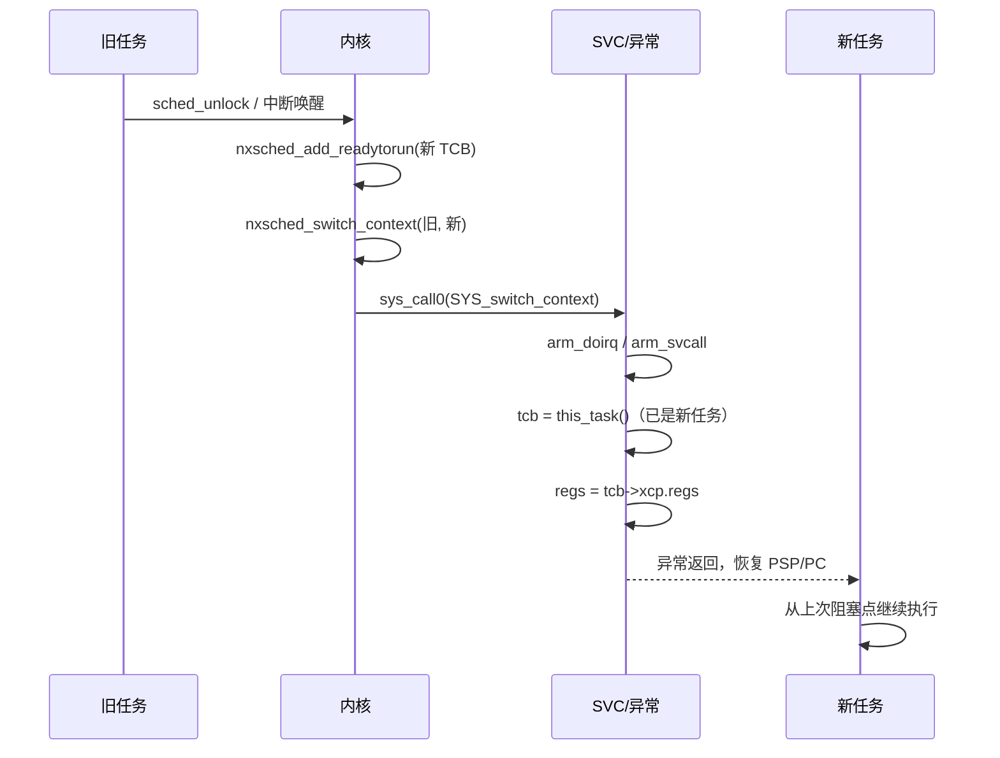
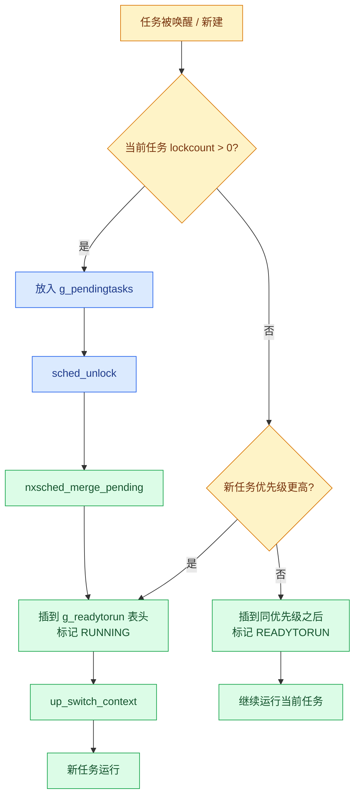
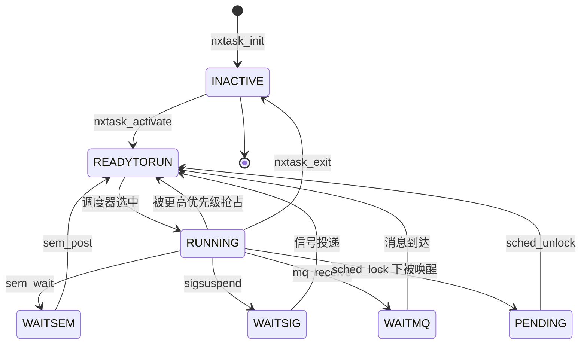
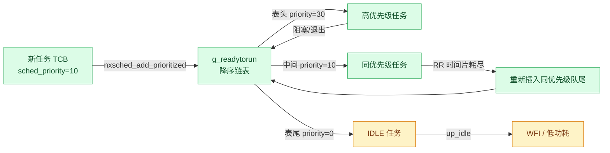

# NuttX 源码详解 02：调度器与任务管理

> 涉及文件（本仓库绝对路径）：
> - `include/nuttx/sched.h`（TCB 与优先级/策略定义，`struct tcb_s` 在 583 行）
> - `sched/sched/sched.h`（`nxsched_add_prioritized()` 在 477 行）
> - `sched/sched/sched_addreadytorun.c`（289 行）
> - `sched/sched/sched_switchcontext.c`（100 行）
> - `sched/sched/sched_setscheduler.c`（约 380 行）
> - `sched/sched/sched_roundrobin.c`、`sched/sched/sched_sporadic.c`
> - `sched/sched/sched_processtick.c`（tick 入口）
> - `sched/sched/sched_setpriority.c`、`sched/sched/sched_reprioritize.c`
> - `arch/arm/include/irq.h`（`up_switch_context` 宏，86-95 行）
> - `arch/arm/src/armv7-m/arm_svcall.c`（SVC 切换分支，96-101 行）
> - `include/sys/types.h`（优先级范围，83-85 行）

---

## 1. 调度器的三张表

NuttX 不用红黑树，也不用位图，而是**按优先级排序的双向链表**。
所有任务状态都映射到 `g_tasklisttable[TSTATE_*]` 这张表里：

| 状态 | 队列 | 是否按优先级排序 | 典型场景 |
|---|---|---|---|
| `TSTATE_TASK_INVALID` | `NULL` | — | TCB 刚分配、尚未初始化 |
| `TSTATE_TASK_READYTORUN` | `g_readytorun` | 是 | 可运行但未占用 CPU |
| `TSTATE_TASK_RUNNING` | 同 `g_readytorun`（单核） | 是 | 表头就是当前任务 |
| `TSTATE_TASK_PENDING` | `g_pendingtasks` | 是 | 抢占被禁止时暂存的高优先级任务 |
| `TSTATE_TASK_INACTIVE` | `g_inactivetasks` | 否 | 已初始化、未激活 |
| `TSTATE_WAIT_SEM` | `sem_t.waitlist`（偏移） | 是 | 等信号量 |
| `TSTATE_WAIT_SIG` | `g_waitingforsignal` | 否 | 等信号 |
| `TSTATE_WAIT_MQNOTEMPTY` | `mqueue.waitfornotempty` | 是 | 等消息队列非空 |
| `TSTATE_WAIT_MQNOTFULL` | `mqueue.waitfornotfull` | 是 | 等消息队列非满 |
| `TSTATE_TASK_STOPPED` | `g_stoppedtasks` | 否 | 被 SIGSTOP 停止 |

这张表由 `tasklist_initialize()` 填好（`sched/init/nx_start.c:226-318`），
关键片段：

```c
  /* TSTATE_TASK_READYTORUN */

  tlist[TSTATE_TASK_READYTORUN].list = list_readytorun();
  tlist[TSTATE_TASK_READYTORUN].attr = TLIST_ATTR_PRIORITIZED |
                                       TLIST_ATTR_RUNNABLE;

  /* TSTATE_TASK_RUNNING */

  tlist[TSTATE_TASK_RUNNING].list = list_readytorun();
  tlist[TSTATE_TASK_RUNNING].attr = TLIST_ATTR_PRIORITIZED |
                                    TLIST_ATTR_RUNNABLE;
```

（`nx_start.c:246-255`）

`TLIST_ATTR_OFFSET` 表示 `.list` 存的不是队列地址，而是结构体成员的偏移
（例如 `offsetof(sem_t, waitlist)`）。`nxsched_add_blocked()` 用它把 TCB
挂到"等待对象内部"的链表上，而不是全局队列。

## 2. 优先级与插入：O(n) 的有序链表

优先级范围在 `include/sys/types.h:83-85`：

```c
#define SCHED_PRIORITY_MAX     255
#define SCHED_PRIORITY_MIN       1
```

IDLE 任务固定为 0，所以有效范围是 0..255，共 256 级。

插入函数是 `nxsched_add_prioritized()`（`sched/sched/sched.h:477-554`）：

```c
static inline_function bool nxsched_add_prioritized(FAR struct tcb_s *tcb,
                                                    DSEG dq_queue_t *list)
{
  FAR struct tcb_s *next;
  FAR struct tcb_s *prev;
  uint8_t sched_priority = tcb->sched_priority;
  bool ret = false;

  /* Lets do a sanity check before we get started. */

  DEBUGASSERT(sched_priority >= SCHED_PRIORITY_MIN);

  /* Search the list to find the location to insert the new Tcb.
   * Each is list is maintained in descending sched_priority order.
   */

  for (next = (FAR struct tcb_s *)list->head;
       (next && sched_priority <= next->sched_priority);
       next = next->flink);
```

（`sched.h:477-495`）

语义要点：

- 链表**降序**，表头优先级最高；
- 循环条件是 `<=`，所以同优先级的新任务会插到所有同优先级任务**之后**，
  这是 FIFO 公平性的来源；
- 返回值 `true` 表示新任务插到了表头，调用者据此决定是否切换；
- 最坏复杂度 O(n)，n 是队列长度；没有优先级位图，所以 256 级并不等于 256 次比较。

## 3. 就绪：`nxsched_add_readytorun()`

```c
  if (nxsched_islocked_tcb(rtcb) &&
      rtcb->sched_priority < btcb->sched_priority)
    {
      /* Yes.  Preemption would occur!  Add the new ready-to-run task to the
       * g_pendingtasks task list for now.
       */

      nxsched_add_prioritized(btcb, list_pendingtasks());
      btcb->task_state = TSTATE_TASK_PENDING;
      ret = false;
    }

  /* Otherwise, add the new task to the ready-to-run task list */

  else if (nxsched_add_prioritized(btcb, list_readytorun()))
    {
      /* The new btcb was added at the head of the ready-to-run list.  It
       * is now the new active task!
       */

      DEBUGASSERT(!nxsched_islocked_tcb(rtcb) && !is_idle_task(btcb));

      btcb->task_state = TSTATE_TASK_RUNNING;
      btcb->flink->task_state = TSTATE_TASK_READYTORUN;
      up_update_task(btcb);
      ret = true;
    }
```

（`sched/sched/sched_addreadytorun.c:90-116`）

三个细节：

1. **抢占锁**：`nxsched_islocked_tcb(rtcb)` 就是 `rtcb->lockcount > 0`。
   锁住期间高优先级任务不能直接插队，只能进 `g_pendingtasks`；
   `sched_unlock()` 时再 `nxsched_merge_pending()` 合并。
2. **RUNNING 与 READY 共用一条链表**：被抢占的旧任务从表头变成
   `TSTATE_TASK_READYTORUN`，仍然留在 `g_readytorun` 里；
   新表头才是 `TSTATE_TASK_RUNNING`。
3. **`up_update_task(btcb)`**：ARMv7-M 用它更新 per-CPU 的当前 TCB 指针
   （`up_update_task` 在 `arch/arm/src/armv7-m/arm_cpustart.c`/`arm_initialize.c`
   附近实现），这样中断里 `this_task()` 不需要查链表。

## 4. 上下文切换：C 只做记账，汇编才换栈

### 4.1 `nxsched_switch_context()` 不是"切换"

```c
void nxsched_switch_context(FAR struct tcb_s *from, FAR struct tcb_s *to)
{
  nxsched_checkstackoverflow(from);

#if CONFIG_RR_INTERVAL > 0 && defined(CONFIG_SCHED_TICKLESS)
  /* If the task being switched out uses round-robin scheduling, account
   * for the time it has consumed from its timeslice.
   */

  if ((from->flags & TCB_FLAG_POLICY_MASK) == TCB_FLAG_SCHED_RR)
    {
      nxsched_suspend_roundrobin(from);
    }
#endif
...
  /* Indicate that the task has been suspended */

#ifdef CONFIG_SCHED_CRITMONITOR
  nxsched_switch_critmon(from, to);
#endif

#ifdef CONFIG_SCHED_INSTRUMENTATION
  sched_note_suspend(from);
  sched_note_resume(to);
#endif
}
```

（`sched/sched/sched_switchcontext.c:50-100`）

它只做四件事：栈溢出检查、RR/sporadic 时间片记账、临界区监控、
trace 打点。**真正的寄存器保存/恢复不在这里**，而在架构相关代码。

### 4.2 ARMv7-M 的切换路径

`include/nuttx/arch.h` 声明 `up_switch_context(tcb, rtcb)`，ARM 在
`arch/arm/include/irq.h:86-95` 用宏覆盖：

```c
#ifndef up_switch_context
#define up_switch_context(tcb, rtcb)   \
  do {                                 \
    if (!up_interrupt_context())       \
      {                                \
        sys_call0(SYS_switch_context); \
      }                                \
      UNUSED(rtcb);                    \
  } while (0)
#endif
```

`sys_call0()` 展开为 `svc SYS_switch_context`。SVC 异常进入
`arm_doirq()` → `irq_dispatch()` → `arm_svcall()`；`arm_svcall()` 在
`SYS_switch_context` 分支里只做一件事：

```c
      case SYS_restore_context:
      case SYS_switch_context:
        {
          tcb = this_task();
          restore_critical_section(tcb, this_cpu());
        }
        break;
```

（`arch/arm/src/armv7-m/arm_svcall.c:96-106`）

`this_task()` 此时已经指向新任务（`nxsched_switch_context()`/调度器已更新
`g_running_tasks[]`），`arm_doirq()` 返回时把 `regs` 换成 `tcb->xcp.regs`：

```c
  tcb = this_task();

  /* Update scheduler parameters.
   * The arm-m architecture svc call will trigger an interrupt,
   * and the actual context switch is executed after doirq is completed,
   * so only the scheduling information needs to be updated in doirq.
   */

  nxsched_switch_context(*running_task, tcb);

  /* Record the new "running" task when context switch occurred.
   * g_running_tasks[] is only used by assertion logic for reporting
   * crashes.
   */

  *running_task = tcb;
  regs = tcb->xcp.regs;
```

（`arch/arm/src/armv7-m/arm_doirq.c:106-122`）

所以完整切换链是：

`up_switch_context()` → `svc` → `arm_doirq()` → `arm_svcall()` →
`this_task()` 换成新 TCB → `arm_doirq()` 返回新 `regs` → 异常返回指令
（`bx lr`，`lr = EXC_RETURN`）恢复新任务的 PSP/MSP 与寄存器。

### 4.3 时序图



## 5. 三种调度策略

### 5.1 FIFO

`TCB_FLAG_SCHED_FIFO`：同优先级任务**不轮转**，谁先就绪谁一直跑，
直到阻塞、退出或被更高优先级抢占。`timeslice` 被清 0
（`sched_setscheduler.c:205-209`）。

### 5.2 RR（时间片轮转）

编译期 `CONFIG_RR_INTERVAL > 0` 时，新建任务默认就是 RR
（`sched/task/task_setup.c:435-437`）：

```c
#if CONFIG_RR_INTERVAL > 0
      tcb->flags         |= TCB_FLAG_SCHED_RR;
      tcb->timeslice      = MSEC2TICK(CONFIG_RR_INTERVAL);
#else
      tcb->flags         |= TCB_FLAG_SCHED_FIFO;
#endif
```

tick 中断里 `nxsched_process_scheduler()` 遍历所有 CPU，调用
`nxsched_cpu_scheduler()`，后者对 RR 任务调
`nxsched_process_roundrobin(rtcb, 1, false)`（`sched/sched/sched_processtick.c:83`）。
时间片耗尽时：

```c
      /* Reset the timeslice. */

      tcb->timeslice = MSEC2TICK(CONFIG_RR_INTERVAL);
      ret = tcb->timeslice;

      /* We know we are at the head of the ready to run prioritized
       * list.  We must be the highest priority task eligible for
       * execution.  Check the next task in the ready to run list.  If
       * it is the same priority, then we need to relinquish the CPU and
       * give that task a shot.
       */

      FAR struct tcb_s *rtcb = this_task();
```

（`sched/sched/sched_roundrobin.c:171-183`）

非 SMP 下用 `nxsched_reprioritize_rtr(tcb, tcb->sched_priority)`
把当前任务重新插到同优先级队尾（`sched_roundrobin.c:213-219`）。
这就是"RR 不需要单独队列"的实现技巧：**改优先级为原值 = 移到队尾**。

### 5.3 SPORADIC

`SCHED_SPORADIC` 是"高优先级预算 + 低优先级补充"的策略。核心参数在
`struct sporadic_s`：`budget`（高优先级预算）、`repl_period`（补充周期）、
`hi_priority`/`lo_priority`。`sporadic_budget_start()` 设置
`tcb->timeslice = sporadic->budget` 并启动 budget 定时器
（`sched/sched/sched_sporadic.c:250-274`）；预算耗尽后
`sporadic_set_lowpriority()` 把任务降到 `lo_priority`，等补充定时器到期
再升回 `hi_priority`。

## 6. 状态机与数据流

先看"一次唤醒要不要立刻切换"的判定：





> 状态机标签不要带括号；上面用中文短语代替。



## 7. 量化：一次插入/切换的成本

- **插入**：`nxsched_add_prioritized()` 最坏遍历整个队列。若有 20 个任务，
  最坏 20 次指针解引用；同优先级任务多时，新任务总在它们之后，所以
  同优先级 FIFO 是 O(1) 摊还（只需走到第一个更低优先级节点）。
- **切换**：ARMv7-M 的 `exception_common` 保存 `r2-r12,r14` 共 12 个字
  （`arm_exception.S:172`），FPU 使能时再保存 `s16-s31` 共 16 个字
  （`arm_exception.S:168`）。一次切换的栈写入量约 48 B（无 FPU）/ 112 B（有 FPU），
  不含流水线冲刷。
- **时间片**：`CONFIG_RR_INTERVAL` 单位是 ms，`MSEC2TICK()` 换算成 tick；
  若 tick 为 100 Hz，`CONFIG_RR_INTERVAL=10` 就是 1 个 tick，实际轮转粒度
  受 tick 精度限制。

## 8. 陷阱与读码建议

- **`TSTATE_TASK_RUNNING` 不是独立队列**：它和 READY 共用 `g_readytorun`，
  只是表头。看到 `list_readytorun()` 里有多个 RUNNING 不要惊讶（SMP 例外）。
- **`lockcount` 不是关中断**：`sched_lock()` 只禁止调度，中断照常；
  临界区要用 `enter_critical_section()`。
- **`nxsched_switch_context()` 名字有误导**：它不换栈，ARM 上真正的切换在
  `arm_doirq()` 返回时发生。
- **RR 依赖 tick**：`CONFIG_SCHED_TICKLESS` 下走
  `nxsched_suspend_roundrobin()`/`nxsched_resume_roundrobin()` 记账，
  不再每个 tick 递减。
- **SMP 下 RUNNING 任务不在 `g_readytorun`**：它在 `g_assignedtasks[cpu]`，
  读 `sched_addreadytorun.c` 的 `#else` 分支（133 行以后）才能看全。
- **读码顺序**：`sched.h` 的 `nxsched_add_prioritized()` → `sched_addreadytorun.c`
  → `sched_switchcontext.c` → `arm_doirq.c` → `arm_svcall.c`。
  配套 KB：[nxsched.md](../../../05-学习笔记与知识库/Knowledge-Base/nuttx/nxsched.md)。
