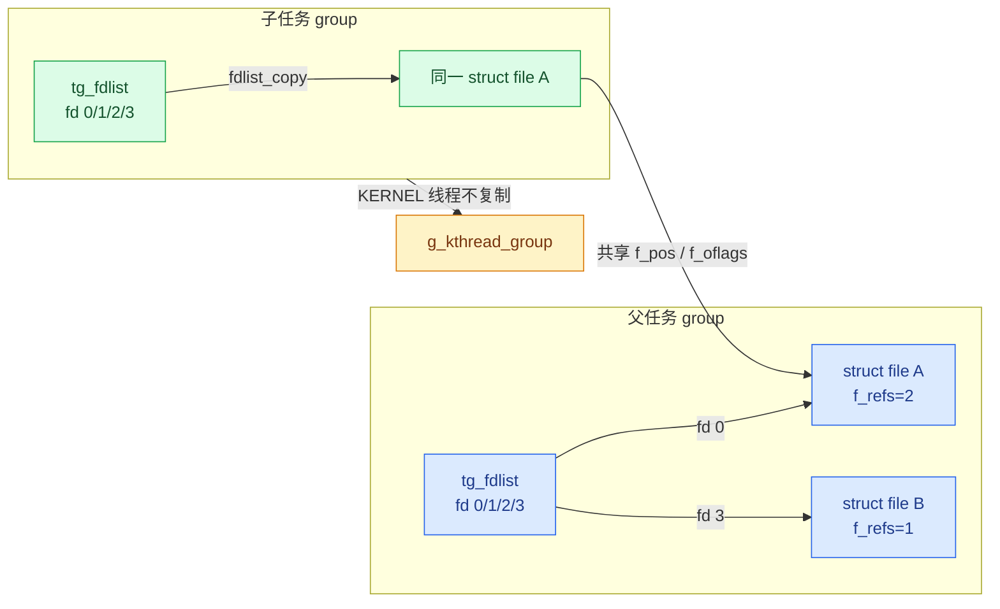
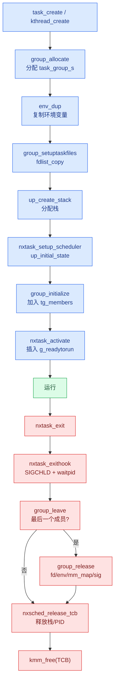
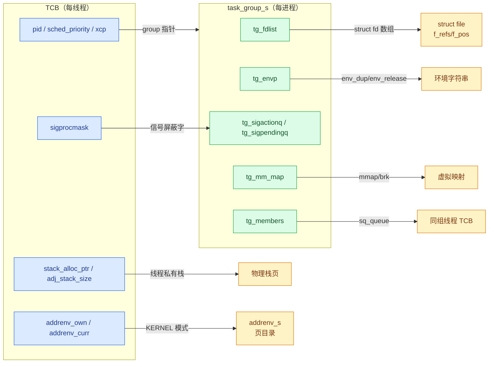

# NuttX 源码详解 03：任务组与地址空间

> 涉及文件（本仓库绝对路径）：
> - `include/nuttx/sched.h`（`struct task_group_s` 在 454 行，TCB 在 583 行）
> - `sched/group/group_create.c`（351 行）：`group_allocate()` / `group_initialize()`
> - `sched/group/group_leave.c`（271 行）：`group_leave()` / `group_release()`
> - `sched/group/group_setuptaskfiles.c`（102 行）：fd 继承
> - `sched/group/group_setupidlefiles.c`（120 行）：IDLE 的 0/1/2 号 fd
> - `sched/task/task_exit.c`（175 行）：`nxtask_exit()`
> - `sched/task/task_exithook.c`（472 行）：退出钩子
> - `sched/sched/sched_releasetcb.c`（195 行）：TCB 资源回收
> - `sched/addrenv/addrenv.c`（543 行）：地址环境切换/加入/离开
> - `include/nuttx/addrenv.h`（`struct addrenv_s` 在 268 行）
> - `fs/inode/fs_files.c`（982 行）：`fdlist_copy()` / `fdlist_free()`

---

## 1. 为什么需要 task group

NuttX 同时支持三种"执行体"：

| 类型 | `TCB_FLAG_TTYPE_*` | group 来源 | fd 表 | 环境变量 | 地址环境 |
|---|---|---|---|---|---|
| 任务 task | `TASK` | 新建 `task_group_s` | 复制父任务 | 复制父任务 | 新建/继承 |
| 线程 pthread | `PTHREAD` | 共享创建者的 group | 共享 | 共享 | 共享 |
| 内核线程 kthread | `KERNEL` | 全局 `g_kthread_group` | 不复制 | 共享全局 | 无（KERNEL 模式） |

POSIX 语义里"进程"拥有的东西——fd 表、环境变量、信号处置、地址空间、
子进程退出状态——在 NuttX 里被打包进 `struct task_group_s`。
`pthread_create()` 不新建 group，所以线程天然共享这些资源；
`task_create()` 新建 group，所以它更像"进程"。

## 2. `struct task_group_s` 字段地图

`struct task_group_s` 从 `include/nuttx/sched.h:454` 开始，按功能分块：

| 字段 | 行号 | 含义 | 谁维护 |
|---|---:|---|---|
| `tg_pid` | 456 | 组内主任务的 PID | `group_initialize()` |
| `tg_ppid` | 457 | 父线程 PID | `nxtask_save_parent()` |
| `tg_flags` | 458 | `GROUP_FLAG_*` | 创建/退出路径 |
| `tg_uid/gid/euid/egid/suid/sgid` | 464-469 | POSIX 身份 | `group_inherit_identity()` |
| `tg_members` | 478 | 组成员链表 | `group_initialize()` / `group_leave()` |
| `tg_children` / `tg_nchildren` | 491-493 | 子进程退出状态 | `group_childstatus.c` |
| `tg_exitcode` | 497 | 组退出码 | `nxtask_exithook()` |
| `tg_joinqueue` | 514 | pthread join 等待队列 | `pthread_join()` |
| `tg_sigactionq` | 527 | 信号处置表 | `nxsig_action()` |
| `tg_sigpendingq` | 530 | 待处理信号 | `nxsig_add_pendingsignal()` |
| `tg_sigdefault` | 533 | 默认动作集合 | `nxsig_default_initialize()` |
| `tg_envp` | 539 | 环境变量数组 | `env_dup()` / `env_release()` |
| `tg_fdlist` | 559 | fd 表 | `fdlist_*()` |
| `tg_mm_map` | 569 | 虚拟内存映射 | `mm_map_*()` |
| `tg_lock` | 571 | 组自旋锁 | 组成员操作 |
| `tg_mutex` | 572 | 组递归互斥 | 组资源分配 |

关键代码：

```c
struct task_group_s
{
  pid_t tg_pid;                     /* The ID of the task within the group      */
  pid_t tg_ppid;                    /* This is the ID of the parent thread      */
  uint8_t tg_flags;                 /* See GROUP_FLAG_* definitions             */
...
  /* File descriptors *******************************************************/

  struct fdlist tg_fdlist;          /* Maps file descriptor to file         */
...
  /* Virtual memory mapping info ********************************************/

  struct mm_map_s tg_mm_map;        /* Task group virtual memory mappings   */

  spinlock_t tg_lock;               /* SpinLock for group */
  rmutex_t   tg_mutex;              /* Mutex for group */
};
```

（`include/nuttx/sched.h:454-570`，节选）

`tg_flags` 的位定义在 `sched.h:116-122`：

| 位 | 名称 | 含义 |
|---:|---|---|
| 0 | `GROUP_FLAG_NOCLDWAIT` | 不保留子进程退出状态（SIGCHLD 的 `SA_NOCLDWAIT`） |
| 1 | `GROUP_FLAG_PRIVILEGED` | 特权组（内核线程或内核堆） |
| 2 | `GROUP_FLAG_DELETED` | 已删除待释放 |
| 3 | `GROUP_FLAG_EXITING` | 组退出进行中 |
| 4 | `GROUP_FLAG_FD_BACKTRACE` | 打开 fd 时记录回溯 |
| 5 | `GROUP_FLAG_SECURE_EXEC` | setuid/setgid 可执行 |
| 6 | `GROUP_FLAG_DUMPABLE` | 可被跟踪/核心转储 |

## 3. 创建：`group_allocate()` 与 `group_initialize()`

### 3.1 两阶段创建

NuttX 把 group 创建拆成两步，原因是**创建过程中可能失败**，
需要一条能回滚的路径：

1. `group_allocate(tcb, ttype)`：分配结构、初始化 fd 表/互斥量/身份；
2. `group_initialize(tcb)`：把 TCB 加入成员链表、设置 `tg_pid`、初始化 mm_map。

`group_allocate()` 的关键分支：

```c
  if (ttype == TCB_FLAG_TTYPE_KERNEL)
    {
      group = &g_kthread_group;
      tcb->group = group;
      if (group->tg_info)
        {
          return OK;
        }
    }
  else
    {
      group = kmm_zalloc(sizeof(struct task_group_s));
    }

  if (!group)
    {
      return -ENOMEM;
    }
```

（`sched/group/group_create.c:195-212`）

内核线程共享一个静态 `g_kthread_group`，只有第一次调用时才真正初始化；
普通任务每次 `kmm_zalloc` 一个新组。这解释了为什么 `kthread_create()`
比 `task_create()` 便宜：没有 group 分配、没有 fd 复制、没有环境复制。

### 3.2 身份与 chroot 继承

`group_allocate()` 在挂上 `tcb->group` 之后，依次调用
`group_inherit_identity()`（`group_create.c:77`，复制 uid/gid/euid/egid/suid/sgid）、
`group_inherit_chroot()`（`group_create.c:122`，复制 chroot 路径）、
`fdlist_init()`、`task_init_info()`、`nxrmutex_init()`（`group_create.c:239-265`）。
前两者是"子进程继承父进程"的 POSIX 语义；后三者是组内资源的初始化。

### 3.3 `group_initialize()`：加入成员

```c
void group_initialize(FAR struct tcb_s *tcb)
{
  FAR struct task_group_s *group;

  DEBUGASSERT(tcb && tcb->group);
  group = tcb->group;
  spin_lock_init(&group->tg_lock);

  /* Allocate mm_map list if required */

  mm_map_initialize(&group->tg_mm_map,
                    (tcb->flags & TCB_FLAG_TTYPE_KERNEL) != 0);

#ifdef HAVE_GROUP_MEMBERS
  /* Assign the PID of this new task as a member of the group. */

  sq_addlast(&tcb->member, &group->tg_members);
#endif
```

（`group_create.c:320-337`）

`mm_map_initialize()`（`mm/map/mm_map.c:112`）在 `CONFIG_ARCH_VMA_MAPPING`
下为**非内核组**创建一个虚拟页分配器，起始地址是 `CONFIG_ARCH_SHM_VBASE`，
大小 `ARCH_SHM_SIZE`，页大小 `MM_PGSHIFT`。这就是 `mmap()` 在用户进程里
能拿到虚拟地址的来源。

## 4. fd 继承：`group_setuptaskfiles()`

```c
int group_setuptaskfiles(FAR struct tcb_s *tcb,
                         FAR const posix_spawn_file_actions_t *actions,
                         bool cloexec)
{
  FAR struct task_group_s *group = tcb->group;
  int ret = OK;
#ifndef CONFIG_FDCLONE_DISABLE
  FAR struct tcb_s *rtcb = this_task();
#endif
...
#ifndef CONFIG_FDCLONE_DISABLE
  DEBUGASSERT(rtcb->group);

  /* With the exception of kernel threads, duplicate the parent task's
   * file descriptors.
   */

  if (group != rtcb->group &&
      (tcb->flags & TCB_FLAG_TTYPE_MASK) != TCB_FLAG_TTYPE_KERNEL)
    {
      ret = fdlist_copy(&rtcb->group->tg_fdlist,
                        &group->tg_fdlist, actions, cloexec);
    }
```

（`sched/group/group_setuptaskfiles.c:62-91`）

三个条件同时满足才复制：

1. 不是 `CONFIG_FDCLONE_DISABLE`；
2. 新旧 group 不同（pthread 不复制，因为共享）；
3. 不是内核线程。

`fdlist_copy()`（`fs/inode/fs_files.c:690`）逐行遍历父 fd 表，
对每个 `f_file` 调 `file_dup()` 增加 `f_refs`，然后 `fdlist_install()`
到子表。注意它复制的是 **`struct file` 的引用**，不是 inode；
父子进程共享同一个打开文件偏移 `f_pos`，这正是 `fork()` 的 POSIX 语义。



### 4.1 IDLE 的 0/1/2 号 fd

`group_setupidlefiles()` 打开 `/dev/console`（没有则 `/dev/null`），
拿到 fd 0 后 `nx_dup2(0,1)`、`nx_dup2(0,2)`：

```c
  fd = nx_open("/dev/console", O_RDWR);
...
  if (fd == 0)
    {
      /* Successfully opened stdin (fd == 0) */

      nx_dup2(0, 1);
      nx_dup2(0, 2);
    }
```

（`sched/group/group_setupidlefiles.c:77-87`）

所有后续任务都从这个 IDLE 组继承 fd 0/1/2，所以应用里 `printf`
不需要自己 open 控制台。

## 5. 退出：四层清理链

任务退出不是"一个函数删掉 TCB"，而是四层：

| 层 | 函数 | 做什么 | 位置 |
|---|---|---|---|
| 1 | `nxtask_exit()` | 从就绪队列摘除自己、切到下一个任务、调 release | `task_exit.c:75` |
| 2 | `nxtask_exithook()` | 发 SIGCHLD、唤醒 waitpid、`group_leave()`、`nxsig_cleanup()` | `task_exithook.c:406` |
| 3 | `nxsched_release_tcb()` | 删定时器、释放 PID、栈、地址环境、join | `sched_releasetcb.c:101` |
| 4 | `group_leave()` / `group_release()` | 最后一个成员离开时释放 fd/环境/mm_map/信号 | `group_leave.c:177` |

### 5.1 `nxtask_exit()`：先摘自己，再切走

```c
  nxsched_remove_self(dtcb);

  /* Get the new task at the head of the ready to run list */

#ifdef CONFIG_SMP
  rtcb = current_task(this_cpu());
#else
  rtcb = this_task();
#endif

  /* We are now in a bad state -- the head of the ready to run task list
   * does not correspond to the thread that is running.  Disabling pre-
   * emption on this TCB and marking the new ready-to-run task as not
   * running.
   *
   * We disable pre-emption here by directly incrementing the lockcount
   * (vs. calling sched_lock()).
   */

  rtcb->lockcount++;

  rtcb->task_state = TSTATE_TASK_READYTORUN;
```

（`sched/task/task_exit.c:101-122`）

注意这里**直接 `rtcb->lockcount++`**，不是 `sched_lock()`。原因是
`sched_lock()` 可能触发 pending 合并/调度，而当前正处于"就绪队列头
不是运行任务"的短暂不一致状态，任何调度都是灾难。

```c
  dtcb->task_state = TSTATE_TASK_INACTIVE;

  /* Update scheduler parameters.
   *
   * When the thread exits, SYS_restore_context is called to
   * restore the context, which does not update the scheduling
   * information.
   * We need to update the scheduling information before tcb is released.
   */

  nxsched_switch_context(dtcb, rtcb);

  sched_note_stop(dtcb);
  ret = nxsched_release_tcb(dtcb, dtcb->flags & TCB_FLAG_TTYPE_MASK);
```

（`task_exit.c:135-148`）

`nxsched_switch_context()` 在这里只做记账（RR/sporadic/critmon/trace），
真正的切换发生在返回用户态/异常返回时。

### 5.2 `nxtask_exithook()`：通知与组离开

```c
  nxsched_dumponexit();

  /* If the task was terminated by another task, it may be in an unknown
   * state.  Make some feeble effort to recover the state.
   */

  nxtask_recover(tcb);

  /* Disable the scheduling function to prevent other tasks from
   * being deleted after they are awakened
   */

  sched_lock();

  /* Send the SIGCHLD signal to the parent task group */

  nxtask_signalparent(tcb, status);

  /* Wakeup any tasks waiting for this task to exit */

  nxtask_exitwakeup(tcb, status);

  sched_unlock();

  /* Leave the task group.  Perhaps discarding any un-reaped child
   * status (no zombies here!)
   */

  group_leave(tcb);

  /* Deallocate anything left in the TCB's queues */

#ifndef CONFIG_DISABLE_ALL_SIGNALS
  nxsig_cleanup(tcb); /* Deallocate Signal lists */
#endif
```

（`sched/task/task_exithook.c:426-460`）

顺序有讲究：先发 SIGCHLD/唤醒 waitpid，再 `group_leave()`；
如果反过来，父进程可能在组资源已释放后才被唤醒，去读 `tg_exitcode` 就悬空了。

### 5.3 `group_leave()`：最后一个成员才释放

```c
      /* Kernel threads share a single statically allocated g_kthread_group.
       * Never call group_release() for them: doing so would destroy shared
       * resources (mutex, fdlist, task_info) while other kernel threads are
       * still using them, causing use-after-free crashes.
       */

      bool release = !(tcb->flags & TCB_FLAG_TTYPE_KERNEL);

      /* Remove the member from group. */

#ifdef HAVE_GROUP_MEMBERS
      flags = spin_lock_irqsave(&group->tg_lock);
      sq_rem(&tcb->member, &group->tg_members);
      release = release && sq_empty(&group->tg_members);
      spin_unlock_irqrestore(&group->tg_lock, flags);

      /* Have all of the members left the group? */
#endif

      if (release)
        {
          /* Yes.. Release all of the resource held by the task group */

          group_release(group);
        }

      /* In any event, we can detach the group from the TCB so that we won't
       * do this again.
       */

      tcb->group = NULL;
```

（`sched/group/group_leave.c:191-221`）

内核线程永远不释放 `g_kthread_group`；普通组要等 `tg_members` 为空。
`group_release()`（`group_leave.c:78-150`）按固定顺序释放：

1. `nxrmutex_destroy(&group->tg_mutex)`；
2. `task_uninit_info(group)`；
3. `group_remove_children(group)`（未回收的子进程状态）；
4. `nxsig_release(group)`；
5. `pthread_release(group)`；
6. `fdlist_free(&group->tg_fdlist)`；
7. `env_release(group)`；
8. `mm_map_destroy(&group->tg_mm_map)`；
9. `binfmt_exit(group->tg_bininfo)`（可加载模块）；
10. 置 `GROUP_FLAG_DELETED`，`group_drop(group)`。

### 5.4 `nxsched_release_tcb()`：TCB 本体

该函数先 `timer_deleteall(tcb->pid)`，再 `nxsched_releasepid()`、
`up_release_stack()`，然后处理 PIC dspace、内核栈、`addrenv_leave()`、
`group_leave()`、`nxtask_joindestroy()`、vfork 父进程恢复，最后如果
`TCB_FLAG_FREE_TCB` 置位才 `kmm_free(tcb)`：静态 TCB（如 IDLE）不释放。
关键片段见 `sched/sched/sched_releasetcb.c:127-137`（PID 与栈的释放）。

## 6. 地址空间：`addrenv_*`

### 6.1 三个指针

TCB 里有三个地址环境相关字段（`include/nuttx/sched.h:612-613`）：

- `addrenv_own`：本任务拥有的地址环境（创建者）；
- `addrenv_curr`：当前生效的地址环境（可能临时切换）；
- `MMU/MPU` 硬件页表由 `arch_addrenv_s` 描述。

`struct addrenv_s` 只有三个字段（`include/nuttx/addrenv.h:268-273`）：

```c
struct addrenv_s
{
  struct arch_addrenv_s addrenv; /* The address environment page directory  */
  struct work_s         work;    /* Worker to free address environment      */
  atomic_t              refs;    /* Users of address environment            */
};
```

### 6.2 切换：`addrenv_switch()`

```c
  next = tcb->addrenv_curr;

  /* Does the group have an address environment? */

  if (!next)
    {
      /* No... just return perhaps leaving a different address environment
       * intact.
       */

      return OK;
    }

  flags = spin_lock_irqsave_nopreempt(&g_addrenv_lock);

  cpu = this_cpu();
  curr = g_addrenv[cpu];

  /* Are we going to change address environments? */

  if (curr != next)
    {
      /* Yes.. Is there a current address environment in place? */

      if (curr)
        {
          /* We need to flush the D-Cache and Invalidate the I-Cache for
           * the group whose environment is disappearing.
           */

          up_addrenv_coherent(&curr->addrenv);
        }

      /* While the address environment is instantiated, it cannot be freed */

      addrenv_take(next);

      /* Instantiate the new address environment (removing the old
       * environment in the process).  For the case of kernel threads,
       * the old mappings will be removed and no new mappings will be
       * instantiated.
       */

      ret = up_addrenv_select(&next->addrenv);
```

（`sched/addrenv/addrenv.c:134-177`）

`g_addrenv[cpu]` 是 per-CPU 的当前地址环境缓存；切换前先
`up_addrenv_coherent()` 刷 D-Cache/失效 I-Cache，因为旧进程的页
即将解除映射。`addrenv_take()` 增加 `refs`，防止在切换过程中被释放。

### 6.3 加入与离开

- `addrenv_join(ptcb, tcb)`（`addrenv.c:273-294`）：`up_addrenv_attach()`，
  `addrenv_take(ptcb->addrenv_own)`，然后
  `tcb->addrenv_own = tcb->addrenv_curr = ptcb->addrenv_own`。
  这是 `pthread_create()`/`vfork()` 共享地址空间的路径。
- `addrenv_fork()`（`addrenv.c:329-357`）：复制页表，没有 COW
  （注释 304-316 行明确说 "The copy is eager"）。
- `addrenv_leave(tcb)`（`addrenv.c:376-390`）：`up_addrenv_detach()`，
  `addrenv_drop(tcb->addrenv_own, false)`，清空指针。

## 7. 全景图





## 8. 陷阱与读码建议

- **`group_leave()` 与 `group_release()` 不是一回事**：前者每个线程退出都调，
  后者只在整个组最后一个成员退出时调。内核线程永远不释放 group。
- **fd 继承复制的是 `struct file` 引用，不是 inode**：父子共享 `f_pos`，
  但 `dup()` 出来的两个 fd 也共享，这与 POSIX 一致。
- **`group_setuptaskfiles()` 对 pthread 不复制**：因为 pthread 共享 group，
  `group == rtcb->group`，条件直接为假。
- **`nxsched_release_tcb()` 可能被调用两次**：错误恢复路径和正常退出路径都会调，
  所以 `group_leave()` 里先把 `tcb->group = NULL`，第二次就什么也不做。
- **KERNEL 模式下 `kmm_*` 与 `umm_*` 完全隔离**：group 里 `group_malloc()`
  会根据 `GROUP_FLAG_PRIVILEGED` 选择 `kmm_malloc()` 或 `kumm_malloc()`
  （`sched/group/group_malloc.c:68-81`）。
- **读码顺序**：`sched.h` 的 `task_group_s` → `group_create.c` →
  `group_setuptaskfiles.c` → `task_exit.c` → `task_exithook.c` →
  `sched_releasetcb.c` → `group_leave.c`。配套 KB：
  [task_exit.md](../../../05-学习笔记与知识库/Knowledge-Base/nuttx/task_exit.md)。
