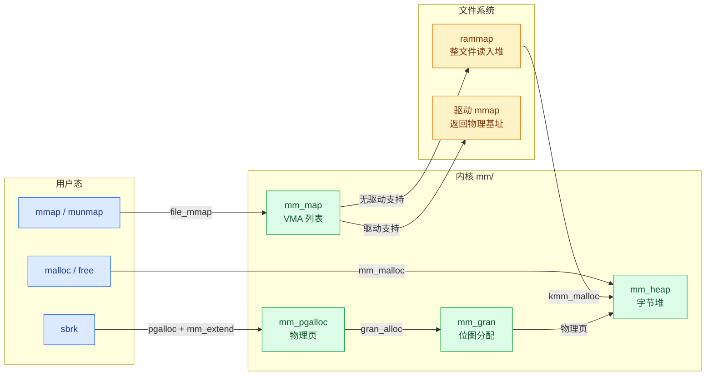

# NuttX 源码详解 04：内存管理

> 涉及文件（本仓库绝对路径）：
> - `mm/mm_heap/mm.h`（`mm_allocnode_s` 175 行、`mm_freenode_s` 192 行、`mm_heap_s` 221 行）
> - `mm/mm_heap/mm_initialize.c`（410 行）：`mm_addregion()`
> - `mm/mm_heap/mm_malloc.c`（413 行）：`mm_malloc()`
> - `mm/mm_heap/mm_free.c`（256 行）：`mm_delayfree()` / `mm_free()`
> - `mm/mm_heap/mm_shrinkchunk.c`（132 行）、`mm/mm_heap/mm_extend.c`（121 行）
> - `mm/mm_heap/mm_memalign.c`（294 行）、`mm/mm_heap/mm_realloc.c`（431 行）
> - `mm/mm_gran/mm_gran.h`（gran 结构）、`mm_graninit.c`（159 行）
> - `mm/mm_gran/mm_grantable.c`（313 行）：位图搜索/置位
> - `mm/mm_gran/mm_granalloc.c`（131 行）、`mm_granfree.c`（74 行）
> - `mm/mm_gran/mm_pgalloc.c`（227 行）：页分配器
> - `mm/umm_heap/umm_sbrk.c`（`sbrk()` 在 76 行）
> - `fs/mmap/fs_mmap.c`（`mmap()` 在 288 行）
> - `mm/map/mm_map.c`（虚拟映射）
> - `mm/Kconfig`（`MM_ALIGN` 默认 8，`MM_BACKTRACE` 默认 -1）

---

## 1. 两套分配器，各管一段

NuttX 的 `mm/` 目录里有两条独立主线：

| 分配器 | 文件 | 粒度 | 典型用途 | 是否可 free 任意指针 |
|---|---|---|---|---|
| `mm_heap` | `mm/mm_heap/*.c` | 字节，8 字节对齐 | `malloc/free/realloc` | 是 |
| `mm_gran` | `mm/mm_gran/*.c` | 2^n 字节的 granule | 页分配、DMA 缓冲、虚拟页 | 是，但必须整 granule |

`mm_gran` 不是"小对象分配器"，而是**位图式固定粒度分配器**：
它把一块连续内存切成 N 个 granule，用 1 bit 表示"已用/空闲"。
`mm_pgalloc` 就是 `log2gran = MM_PGSHIFT` 的 `mm_gran` 特例。

## 2. `mm_heap`：带边界标记的 dlmalloc 简化版

### 2.1 堆的物理布局

`mm_addregion()`（`mm/mm_heap/mm_initialize.c:103`）把一块内存挂到堆上：

```c
  heapbase = MM_ALIGN_UP((uintptr_t)heapstart + 2 * MM_SIZEOF_ALLOCNODE) -
             2 * MM_SIZEOF_ALLOCNODE;
  heapsize = heapsize - (heapbase - (uintptr_t)heapstart);
...
  heap->mm_heapstart[idx]->size    = MM_SIZEOF_ALLOCNODE | MM_ALLOC_BIT;
  node->size                       = heapsize - 2 * MM_SIZEOF_ALLOCNODE;
  heap->mm_heapend[idx]->size      = MM_SIZEOF_ALLOCNODE | MM_ALLOC_BIT |
                                     MM_PREVFREE_BIT;
  heap->mm_heapend[idx]->preceding = node->size;
```

（`mm_initialize.c:151-199`，节选）

布局是"guard node + 一个大空闲块 + guard node"：两个 guard 永远标记为
allocated，防止 `free()`/`malloc()` 越界合并到堆外；它们不是用户可见的块。

### 2.2 节点头：8 字节起步

```c
struct mm_allocnode_s
{
  mmsize_t preceding;                       /* Physical preceding chunk size */
  mmsize_t size;                            /* Size of this chunk */
#if CONFIG_MM_BACKTRACE >= 0
  pid_t pid;                                /* The pid for caller */
#  ifdef CONFIG_MM_BACKTRACE_SEQNO
  unsigned long seqno;                      /* The sequence of memory malloc */
#  endif
#  if CONFIG_MM_BACKTRACE > 0
  FAR void *backtrace[CONFIG_MM_BACKTRACE]; /* The backtrace buffer for caller */
#  endif
#endif
};
```

（`mm/mm_heap/mm.h:175-188`）

| 配置 | 32 位下的头大小 | 用户可见开销 |
|---|---:|---:|
| `MM_BACKTRACE=-1`（默认） | `preceding+size` = 8 B | 4 B（`preceding` 算在前一块里） |
| `MM_BACKTRACE=0` | +`pid` = 12 B | 8 B |
| `MM_BACKTRACE=8` | +`pid+seqno+8*ptr` = 48 B | 44 B |

`MM_ALLOCNODE_OVERHEAD` 的定义正是"头大小减去 `preceding`"：

```c
#define MM_ALLOCNODE_OVERHEAD (CONFIG_MM_NODE_GUARDSIZE + \
                               MM_SIZEOF_ALLOCNODE - sizeof(mmsize_t))
```

（`mm/mm_heap/mm.h:146-147`）

因为 `preceding` 位于前一个 chunk 的尾部，物理上不属于当前 chunk 的
"额外"开销。这也是为什么默认配置下每块只有 4 B 额外开销。

### 2.3 空闲链表：分箱 + 大小有序

`mm_heap_s` 里有 `mm_nodelist[MM_NNODES]`（`mm.h:253`），
`MM_NNODES = MM_MAX_SHIFT - MM_MIN_SHIFT + 1`（`mm.h:116`）：

- `MM_MIN_SHIFT = LOG2_CEIL(sizeof(struct mm_freenode_s))`；
  32 位、backtrace 关时 `mm_freenode_s` 是
  `preceding+size+flink+blink = 16 B`，所以 `MM_MIN_CHUNK = 16 B`；
- `MM_MAX_SHIFT = 22`（`CONFIG_MM_SMALL` 且 32 位地址时是 15），
  即最大单块 4 MB；
- 因此默认 `MM_NNODES = 22 - 4 + 1 = 19` 个 bin。

`mm_size2ndx()`（`mm.h:329` 附近）把请求大小映射到 bin：

```c
static inline_function int mm_size2ndx(size_t size)
{
  DEBUGASSERT(size >= MM_MIN_CHUNK);
  if (size >= MM_MAX_CHUNK)
    {
      return MM_NNODES - 1;
    }

  size >>= MM_MIN_SHIFT;
  return flsl(size) - 1;
}
```

同一个 bin 内的空闲块按大小升序排列，所以找到的第一个"足够大"的块
就是该 bin 里的最佳适配（best fit），但不一定是全局最佳。

## 3. `mm_malloc()`：分配路径

```c
  if (size < MM_MIN_CHUNK - MM_ALLOCNODE_OVERHEAD)
    {
      size = MM_MIN_CHUNK - MM_ALLOCNODE_OVERHEAD;
    }

  alignsize = MM_ALIGN_UP(size + MM_ALLOCNODE_OVERHEAD);
  if (alignsize < size)
    {
      /* There must have been an integer overflow */

      return NULL;
    }

  DEBUGASSERT(alignsize >= MM_ALIGN);

  /* We need to hold the MM mutex while we muck with the nodelist. */

  DEBUGVERIFY(mm_lock(heap));

  /* Convert the request size into a nodelist index */

  ndx = mm_size2ndx(alignsize);

  /* Search for a large enough chunk in the list of nodes. This list is
   * ordered by size, but will have occasional zero sized nodes as we visit
   * other mm_nodelist[] entries.
   */

  for (node = heap->mm_nodelist[ndx].flink; node; node = node->flink)
    {
      DEBUGASSERT(node->blink->flink == node);
      nodesize = MM_SIZEOF_NODE(node);
      if (nodesize >= alignsize)
        {
          break;
        }
    }
```

（`mm/mm_heap/mm_malloc.c:198-234`）

四步：

1. **最小块**：`MM_MIN_CHUNK - MM_ALLOCNODE_OVERHEAD`，保证切割后
   剩余部分至少能放下一个空闲节点；
2. **对齐**：`alignsize = align_up(size + overhead)`，默认 8 B 对齐；
3. **定位 bin**：`mm_size2ndx()`；
4. **线性搜索**：从该 bin 开始向后找第一个 `nodesize >= alignsize` 的块。

找到后从链表摘除，若剩余空间 `>= MM_MIN_CHUNK` 就切成两块，否则把
剩余几个字节"浪费"在块尾：

```c
      remaining = nodesize - alignsize;
      if (remaining >= MM_MIN_CHUNK)
        {
          /* Create the remainder node */

          remainder = (FAR struct mm_freenode_s *)
            (((FAR char *)node) + alignsize);

          remainder->size = remaining;

          /* Adjust the size of the node under consideration */

          node->size = alignsize | (node->size & MM_MASK_BIT);

          /* Adjust the 'preceding' size of the (old) next node. */

          next->preceding = remaining;

          /* Add the remainder back into the nodelist */

          mm_addfreechunk(heap, remainder);
        }
      else
        {
          /* Previous physical memory node is alloced, so clear the previous
           * free bit in next->size.
           */

          next->size &= ~MM_PREVFREE_BIT;
        }
```

（`mm_malloc.c:277-306`）

`next->preceding = remaining` 是边界标记的关键：每个块都记录
**物理前一块**的大小，`free()` 时才能 O(1) 找到前一块。

## 4. `mm_free()`：合并相邻空闲块

`mm_free()` 本身只是入口（`mm_free.c:232-256`），真正逻辑在
`mm_delayfree()`（`mm_free.c:84-221`）：

```c
  if (mm_lock(heap) < 0)
    {
      /* Meet -ESRCH return, which means we are in situations
       * during context switching(See mm_lock() & gettid()).
       * Then add to the delay list.
       */

      add_delaylist(heap, mem);
      return;
    }
```

（`mm_free.c:92-101`）

`mm_lock()` 在"正在上下文切换、拿不到当前 TID"时返回 `-ESRCH`，
这时不能阻塞等锁，只能把指针挂到 per-CPU 的 `mm_delaylist`，
等下次 `malloc` 或显式 `mm_free_delaylist()` 再真正释放。
这是 NuttX 堆实现里最容易忽略的并发路径。

合并分两步：

1. **向后合并**：`next = node + nodesize`，若 `MM_NODE_IS_FREE(next)`，
   从空闲链表摘除 `next`，`nodesize += nextsize`，更新 `andbeyond->preceding`；
2. **向前合并**：若 `MM_PREVNODE_IS_FREE(node)`，
   `prev = node - node->preceding`，摘除 `prev`，`prevsize += nodesize`。

```c
  next = (FAR struct mm_freenode_s *)((FAR char *)node + nodesize);
  DEBUGASSERT(MM_PREVNODE_IS_ALLOC(next));
  if (MM_NODE_IS_FREE(next))
    {
...
      nodesize            += nextsize;
      node->size           = nodesize | (node->size & MM_MASK_BIT);
      andbeyond->preceding = nodesize;
      next                 = (FAR struct mm_freenode_s *)andbeyond;
    }
  else
    {
      next->size     |= MM_PREVFREE_BIT;
      next->preceding = nodesize;
    }
```

（`mm_free.c:147-185`）

注意 `node->size = nodesize | (node->size & MM_MASK_BIT)` 保留了
`MM_ALLOC_BIT`/`MM_PREVFREE_BIT`，只改大小字段。

## 5. `realloc` 与 `shrinkchunk`

`mm_realloc()`（`mm_realloc.c`）在缩小或对齐时调用
`mm_shrinkchunk()`（`mm_shrinkchunk.c:54`）。它有两种情况：

- 下一块空闲：把下一块和"本块尾部"合并成一个新空闲块；
- 下一块已分配且剩余 `>= MM_MIN_CHUNK`：在本块尾部切出一个新空闲块
  （`mm_shrinkchunk.c:111-131`，核心是 `newnode->size = nodesize - size`，
  再 `mm_addfreechunk()`）。

## 6. `mm_gran`：位图式颗粒分配

### 6.1 结构

```c
struct gran_s
{
  uint8_t    log2gran;  /* Log base 2 of the size of one granule */
  uint8_t    log2align; /* Log base 2 of required alignment */
  uint16_t   ngranules; /* The total number of (aligned) granules in the heap */
#ifdef CONFIG_GRAN_INTR
  irqstate_t irqstate;  /* For exclusive access to the GAT */
  spinlock_t lock;
#else
  mutex_t    lock;       /* For exclusive access to the GAT */
#endif
  uintptr_t  heapstart; /* The aligned start of the granule heap */
  uint32_t   gat[1];    /* Start of the granule allocation table */
};
```

（`mm/mm_gran/mm_gran.h:74-84`）

- `log2gran`：granule 大小，例如 6 表示 64 B；
- `log2align`：对齐要求，必须 `<= log2gran`；
- `ngranules`：`uint16_t`，所以**最多 65535 个 granule**；
- `gat[]`：位图，1 bit/granule，32 bit/cell。

### 6.2 初始化

```c
  mask         = (1 << log2align) - 1;
  alignedstart = ((uintptr_t)heapstart + mask) & ~mask;

  /* Determine the number of granules */

  mask         = (1 << log2gran) - 1;
  heapend      = (uintptr_t)heapstart + heapsize;
  alignedsize  = (heapend - alignedstart) & ~mask;
  ngranules    = alignedsize >> log2gran;

  /* Reject oversized pools. */

  DEBUGASSERT(ngranules > 0 && ngranules <= UINT16_MAX);
  if (ngranules == 0 || ngranules > UINT16_MAX)
    {
      return NULL;
    }

  /* Allocate the information structure with a granule table of the
   * correct size.
   */

  priv = kmm_zalloc(SIZEOF_GRAN_S(ngranules));
```

（`mm/mm_gran/mm_graninit.c:117-139`）

`SIZEOF_GRAN_S(n) = sizeof(struct gran_s) + 4 * ((n+31)/32 - 1)`，
即"结构体 + 位图"。注意 `gran_s` 的 `gat[1]` 是柔性数组写法，
`kmm_zalloc` 保证位图初始全 0（全部空闲）。

### 6.3 分配：线性扫描 + 位图置位

```c
  ngran = NGRANULE(gran, size);
  if (!ngran || ngran > gran->ngranules)
    {
      return NULL;
    }

  ret = gran_enter_critical(gran);
  if (ret < 0)
    {
      return NULL;
    }

  posi = gran_search(gran, ngran);
  if (posi >= 0)
    {
      gran_set(gran, posi, ngran);
    }

  gran_leave_critical(gran);
  if (posi < 0)
    {
      return NULL;
    }

  retp = gran->heapstart + (posi << gran->log2gran);
```

（`mm/mm_gran/mm_granalloc.c:52-76`）

`NGRANULE(g, s) = (s + (1<<log2gran) - 1) >> log2gran`（`mm_grantable.h:34`），
向上取整。`gran_search()`（`mm_grantable.c:260`）从 0 开始线性扫描：

```c
  ret = -ENOMEM;
  for (i = 0; i <= gran->ngranules - size; i++)
    {
      if (gran_match(gran, i, size, 0, &i))
        {
          ret = i;
          break;
        }
    }
```

`gran_match()` 用 32 位掩码一次检查一个 cell（32 个 granule），
`gran_range()` 计算起止 cell 的 `sidx/eidx/soff/eoff/smask/emask`。
这是教科书式的位图 first-fit。

### 6.4 释放

```c
void gran_free(GRAN_HANDLE handle, FAR void *memory, size_t size)
{
...
  do
    {
      ret = gran_enter_critical(gran);
      DEBUGASSERT(ret == OK || ret == -ECANCELED);
    }
  while (ret < 0);  /* Retry upon task cancellation */

  /* check double free */

  DEBUGASSERT(gran_match(gran, posi, ngran, 1, NULL));
  gran_clear(gran, posi, ngran);
  gran_leave_critical(gran);
}
```

（`mm/mm_gran/mm_granfree.c:43-72`）

两个细节：

- **重试**：`gran_enter_critical()` 可能返回 `-ECANCELED`（等待锁时被信号取消），
  这里用 `do/while` 重试，而不是把错误抛给调用者；
- **双重释放检测**：`gran_match(..., used=1, ...)` 在 `DEBUGASSERT` 里
  确认这些 granule 确实都是"已用"，否则断言。

### 6.5 量化：位图开销

| granule 大小 | 堆大小 | granule 数 | GAT 字节数 | 开销比 |
|---:|---:|---:|---:|---:|
| 16 B | 64 KiB | 4096 | 512 B | 0.78% |
| 64 B | 64 KiB | 1024 | 128 B | 0.20% |
| 64 B | 4 MiB | 65536 | 8192 B | 0.20% |

公式：`GAT = ceil(n/32) * 4` 字节；`ngranules` 是 `uint16_t`，超过 65535
就 `gran_initialize()` 返回 `NULL`。

## 7. `mmap` 与 `brk`：用户态看到的"虚拟内存"

### 7.1 `sbrk()` 在 KERNEL 模式下的路径

```c
  /* Get the current break address (NOTE: assumes region 0). */

  brkaddr = (uintptr_t)mm_brkaddr(USR_HEAP, 0);
  if (incr > 0)
    {
      /* Convert the increment to multiples of the page size */

      pgincr = MM_NPAGES(incr);

      /* Allocate the requested number of pages and map them to the
       * break address.
       */

      allocbase = pgalloc(brkaddr, pgincr);
      if (allocbase == 0)
        {
          errcode = EAGAIN;
          goto errout;
        }

      /* Extend the heap (region 0) */

      bytesize = pgincr << MM_PGSHIFT;
      mm_extend(USR_HEAP, (FAR void *)allocbase, bytesize, 0);
    }
```

（`mm/umm_heap/umm_sbrk.c:97-119`）

`sbrk()` 只支持正增量（84-89 行对负增量返回 `ENOSYS`）。
它先按页分配物理页，再 `mm_extend()` 把这段内存接到堆尾。
`mm_extend()`（`mm_extend.c:54-121`）把旧的 heapend guard 节点"拉长"到
新块末尾，然后 `mm_free(heap, mem)` 把新块变成空闲节点。

### 7.2 `mmap()` 的两条路径

`fs/mmap/fs_mmap.c` 的 `file_mmap_()` 先检查参数，然后：

```c
  /* Call driver's mmap to get the base address of the file in 'mapped'
   * ...
   */

  if (inode->u.i_ops != NULL && inode->u.i_ops->mmap != NULL)
    {
      ret = filep->f_inode->u.i_ops->mmap(filep, &entry);
    }
...
  else
    {
      ret = rammap(filep, &entry, type);
    }
```

（`fs/mmap/fs_mmap.c:154-175`，节选）

- **驱动 mmap**：文件系统/驱动直接返回物理基地址，VFS 把它记录到
  `mm_map_entry_s`；
- **RAM map**：`CONFIG_FS_RAMMAP` 下，`rammap()` 把整个文件读进堆，
  返回堆地址；`munmap()` 时再写回（如果可写）。

### 7.3 虚拟映射表

`mm_map` 是 task group 级别的 VMA 列表（`task_group_s.tg_mm_map`）。
`mm_map_initialize()` 在 `CONFIG_ARCH_VMA_MAPPING` 下用
`gran_initialize(CONFIG_ARCH_SHM_VBASE, ARCH_SHM_SIZE, ...)` 创建一个
"虚拟页号分配器"，专门给 `mmap()` 分配虚拟地址，不消耗物理页。

## 8. 全景图




## 9. 碎片与量化

假设堆 64 KiB，按 8 B 对齐，默认头开销 4 B。分配 1000 个 60 B 块：
每块实际占用 `align_up(60+4)=64 B`，总占用 64,000 B，用户有效载荷
60,000 B，**碎片率 6.25%**。全部释放后若物理相邻会合并成一个大块；
若中间夹着长期块，就形成大量 64 B 空洞——这是**外部碎片**。
用 `mm_mallinfo()` 读 `mxordblk`（最大连续空闲块）可直接量化碎片程度。

## 10. 陷阱与读码建议

- **`free()` 可能延迟**：`CONFIG_MM_FREE_DELAYCOUNT_MAX > 0` 时先挂 delay list，
  调试"内存没释放"先看这个配置。
- **`mm_lock()` 可能返回 `-ESRCH`**：上下文切换期间拿不到 TID，
  这不是错误，调用者必须走 delay list。
- **`MM_MIN_CHUNK` 随 `sizeof(struct mm_freenode_s)` 变**：打开
  `CONFIG_MM_BACKTRACE` 会增大空闲节点，进而增大最小块和内部碎片。
- **`gran_alloc` 按 granule 对齐而非字节对齐**：申请 47 B、granule 64 B
  时实际占 64 B，浪费 17 B。
- **`ngranules` 是 16 位**：4 MiB / 64 B = 65536 刚好越界，`gran_initialize()`
  会拒绝；要么增大 granule，要么缩小堆。
- **读码顺序**：`mm.h` 节点结构 → `mm_addregion()` → `mm_malloc.c` →
  `mm_free.c` → `mm_grantable.c` → `mm_granalloc.c`。配套 KB：
  [mm_heap.md](../../../05-学习笔记与知识库/Knowledge-Base/nuttx/mm_heap.md)、
  [mm_gran.md](../../../05-学习笔记与知识库/Knowledge-Base/nuttx/mm_gran.md)。
