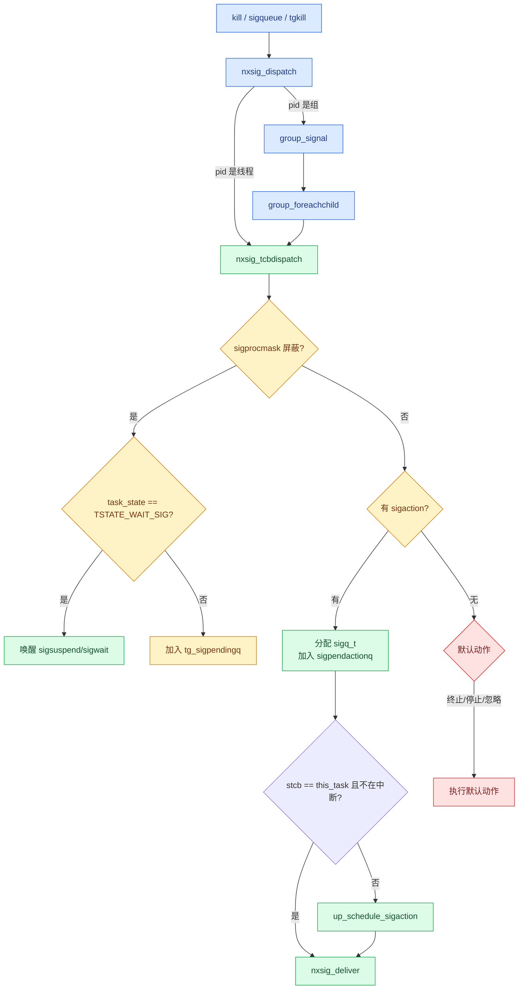
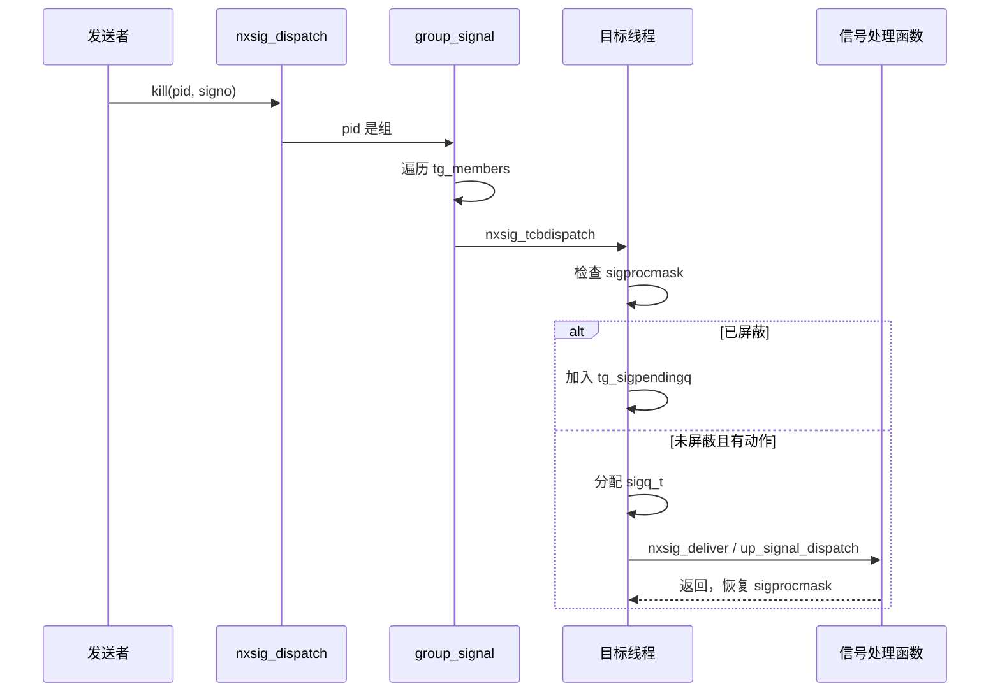
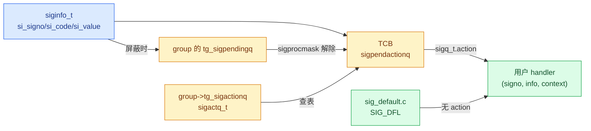

# NuttX 源码详解 05：POSIX 信号机制

> 涉及文件（本仓库绝对路径）：
> - `sched/signal/signal.h`（`sigactq_t` / `sigpendq_t` / `sigq_t` 定义）
> - `sched/signal/sig_action.c`（`nxsig_action()` / `sigaction()`）
> - `sched/signal/sig_procmask.c`（212 行）：`sigprocmask()`
> - `sched/signal/sig_dispatch.c`（约 800 行）：`nxsig_tcbdispatch()` / `nxsig_dispatch()`
> - `sched/signal/sig_deliver.c`：`nxsig_deliver()`
> - `sched/signal/sig_unmaskpendingsignal.c`（120 行）
> - `sched/signal/sig_kill.c`（171 行）、`sched/signal/sig_queue.c`
> - `sched/signal/sig_default.c`：默认动作（SIG_DFL）
> - `sched/signal/sig_initialize.c`（217 行）：全局空闲链表
> - `sched/group/group_signal.c`（282 行）：进程定向投递
> - `include/nuttx/sched.h`：TCB 里的 `sigprocmask` / `sigpendactionq` / `sigpostedq`

---

## 1. 三类数据结构

信号机制里最容易混的是三个队列，它们分别位于不同层级：

| 结构 | 定义 | 挂在哪里 | 生命周期 | 作用 |
|---|---|---|---|---|
| `sigactq_t` | `signal.h:69` | `group->tg_sigactionq` | 直到 `sigaction()` 覆盖或进程退出 | "这个信号该怎么处理" |
| `sigpendq_t` | `signal.h:82` | `group->tg_sigpendingq` | 直到被投递/丢弃 | "这个信号已经来了，但被屏蔽" |
| `sigq_t` | `signal.h:101` | `tcb->sigpendactionq` → `tcb->sigpostedq` | 一次投递 | "马上要在这个线程上执行的动作" |

```c
struct sigactq
{
  FAR struct sigactq *flink;     /* Forward link */
  struct sigaction act;          /* Sigaction data */
  uint8_t   signo;               /* Signal associated with action */
};
typedef struct sigactq  sigactq_t;

struct sigpendq
{
  FAR struct sigpendq *flink;    /* Forward link */
  FAR struct tcb_s *tcb;         /* TCB of thread to deliver to */
  siginfo_t info;                /* Signal information */
  uint8_t   type;                /* (Used to manage allocations) */
};
typedef struct sigpendq sigpendq_t;

struct sigq_s
{
  FAR struct sigq_s *flink;      /* Forward link */
  union
  {
    void (*sighandler)(int signo, siginfo_t *info, void *context);
  } action;                      /* Signal action */
  sigset_t  mask;                /* Additional signals to mask while the
                                  * the signal-catching function executes */
  siginfo_t info;                /* Signal information */
  uint8_t   type;                /* (Used to manage allocations) */
};
typedef struct sigq_s sigq_t;
```

（`sched/signal/signal.h:67-113`）

**关键区别**：`sigactq_t` 是"配置"，每组一份；`sigpendq_t` 是"待处理"，
每组一份，非实时信号只保留一份（后来的覆盖先来的）；`sigq_t` 是"待执行"，
每线程一份，按到达顺序排队。

## 2. `sigaction()`：安装处置

`nxsig_action()`（`sched/signal/sig_action.c:211`）是核心，`sigaction()`
只是它的 POSIX 包装。它做四件事：

1. 校验信号号与可捕获性；
2. 查旧动作并回填 `oact`；
3. `act == NULL` 时只查询，直接返回；
4. 特殊处理 `SIGCHLD + SA_NOCLDWAIT`。

```c
int nxsig_action(int signo, FAR const struct sigaction *act,
                 FAR struct sigaction *oact, bool force)
{
  FAR struct tcb_s *rtcb = this_task();
  FAR struct task_group_s *group;
  FAR sigactq_t *sigact;
  _sa_handler_t handler;
  irqstate_t flags;

  /* Since sigactions can only be installed from the running thread of
   * execution, no special precautions should be necessary.
   */

  DEBUGASSERT(rtcb != NULL);

  group = rtcb->group;

  /* If the value of group is null, the task may have exited */

  if (group == NULL)
    {
      return -EINVAL;
    }

  /* Verify the signal number */

  if (!GOOD_SIGNO(signo))
    {
      return -EINVAL;
    }
```

（`sig_action.c:211-240`）

```c
#ifdef CONFIG_SIG_DEFAULT
  /* Check if the user is trying to catch or ignore a signal that cannot be
   * caught or ignored.
   */

  if (act != NULL && !force && act->sa_handler != SIG_DFL &&
      !nxsig_iscatchable(signo))
    {
      return -EINVAL;
    }
#endif

  /* Find the signal in the signal action queue */

  sigact = nxsig_find_action(group, signo);
```

（`sig_action.c:242-256`）

`force` 参数只有内核内部用（`SIG_DFL` 的默认动作由内核强制安装）。
用户态传 `SIGKILL`/`SIGSTOP` 给 `sigaction()` 会被 `nxsig_iscatchable()`
拒绝，符合 POSIX。

`SA_NOCLDWAIT` 的处理：

```c
  if (signo == SIGCHLD && (act->sa_flags & SA_NOCLDWAIT) != 0)
    {
      /* We do require a critical section to muck with the TCB values that
       * can be modified by the child thread.
       */

      flags = enter_critical_section();

      /* Mark that status should be not be retained */

      rtcb->group->tg_flags |= GROUP_FLAG_NOCLDWAIT;

      /* Free all pending exit status */

      group_remove_children(rtcb->group);
      leave_critical_section(flags);
    }
```

（`sig_action.c:312-328`）

## 3. `sigprocmask()`：屏蔽字

```c
int nxsig_procmask(int how, FAR const sigset_t *set, FAR sigset_t *oset)
{
  FAR struct tcb_s *rtcb = this_task();
  irqstate_t flags;
  int        ret = OK;

  /* Return the old signal mask if requested */

  if (oset != NULL)
    {
      *oset = rtcb->sigprocmask;
    }

  /* Modify the current signal mask if so requested */

  if (set != NULL)
    {
      /* Some of these operations are non-atomic.  We need to protect
       * ourselves from attempts to process signals from interrupts
       */

      flags = enter_critical_section();

      /* Okay, determine what we are supposed to do */

      switch (how)
        {
          case SIG_BLOCK:
            sigorset(&rtcb->sigprocmask, &rtcb->sigprocmask, set);
            break;

          case SIG_UNBLOCK:
            nxsig_nandset(&rtcb->sigprocmask, &rtcb->sigprocmask, set);
            break;

          case SIG_SETMASK:
            rtcb->sigprocmask = *set;
            break;

          default:
            ret = -EINVAL;
            break;
        }

      leave_critical_section(flags);

      /* Now, process any pending signals that were just unmasked */

      nxsig_unmask_pendingsignal();
    }

  return ret;
}
```

（`sched/signal/sig_procmask.c:90-152`）

要点：

- `sigprocmask` 是**每线程**的（在 TCB 里），不是每进程；
- 修改后立刻调 `nxsig_unmask_pendingsignal()`，把刚解除屏蔽的待处理信号
  立刻投递。POSIX 要求"在 sigprocmask 返回前至少投递一个"；
- `SIG_UNBLOCK` 用 `nxsig_nandset()`，语义是 `current & ~set`。

## 4. 投递：`nxsig_dispatch()` 的决策树

`nxsig_tcbdispatch()`（`sched/signal/sig_dispatch.c:489`）是所有信号的
最终汇聚点。它的主决策只有一条：

```c
  masked = nxsig_ismember(&stcb->sigprocmask, info->si_signo);
...
  if ((masked == 1) || (stcb->flags & TCB_FLAG_SYSCALL) != 0)
    {
      /* Check if the task is waiting for this pending signal. If so, then
       * unblock it. ...
       */

      if (stcb->task_state == TSTATE_WAIT_SIG &&
          (masked == 0 ||
           (nxsig_ismember(&stcb->sigwaitmask, info->si_signo) == 1)))
        {
          ...
          dq_rem((FAR dq_entry_t *)stcb, list_waitingforsignal());

          /* Add the task to ready-to-run task list and
           * perform the context switch if one is needed
           */

          if (nxsched_add_readytorun(stcb))
            {
              up_switch_context(this_task(), rtcb);
            }
        }

      /* Its not one we are waiting for... Add it to the list of pending
       * signals.
       */

      else
        {
          sigpend = nxsig_add_pendingsignal(stcb, info, group_dispatch);
        }
    }
```

（`sig_dispatch.c:539-626`，节选）

未屏蔽分支则查组动作并排队：

```c
  else
    {
#ifdef CONFIG_ENABLE_ALL_SIGNALS
      /* Find if there is a group sigaction associated with this signal */

      sigact = nxsig_find_action(stcb->group, info->si_signo);

      /* Queue any sigaction's requested by this task. */

      ret = nxsig_queue_action(stcb, sigact, info);
#endif
```

（`sig_dispatch.c:630-638`）

`nxsig_queue_action()`（`sig_dispatch.c:112`）分配一个 `sigq_t`，
挂到 `stcb->sigpendactionq`，然后：

```c
          if (!stcb->sigdeliver)
            {
...
                  stcb->sigdeliver = nxsig_deliver;
                  if (stcb == this_task() && !up_interrupt_context())
                    {
                      /* In this case just deliver the signal now. */

                      (stcb->sigdeliver)(stcb);
                      stcb->sigdeliver = NULL;
                    }
                  else
                    {
                      up_schedule_sigaction(stcb);
                    }
            }
```

（`sig_dispatch.c:160-199`）

三种投递时机：

1. **自发自收**（`stcb == this_task()` 且不在中断）：直接调
   `nxsig_deliver()`；
2. **别的线程**：`up_schedule_sigaction()` 在目标线程的上下文里
   安排一次信号处理（ARM 上通过 `PendSV` 或修改 `xcp.regs`）；
3. **SMP 跨核**：`nxsched_smp_call_single()` 给目标 CPU 发 IPI。

## 5. `nxsig_deliver()`：真正执行 handler

```c
void nxsig_deliver(FAR struct tcb_s *stcb)
{
...
  for (; ; )
    {
      /* Test if this task is already handling a signal (we don't permit
       * nested signals on the same thread).
       */

      flags = enter_critical_section();
      if ((stcb->flags & TCB_FLAG_SIGNAL_ACTION) != 0)
        {
          /* Yes.. then we must wait for the signal handler to return */

          leave_critical_section(flags);
          break;
        }

      /* Remove the signal structure from the head of the sigpendactionq. */

      sigq  = (FAR sigq_t *)sq_remfirst(&stcb->sigpendactionq);
      if (sigq == NULL)
        {
          /* All queued signal actions have been dispatched */

          leave_critical_section(flags);
          break;
        }

      /* Indicate that a signal is being delivered */

      stcb->flags |= TCB_FLAG_SIGNAL_ACTION;
```

（`sched/signal/sig_deliver.c:74-102`）

之后它：

1. 把 `sigq` 从 `sigpendactionq` 移到 `sigpostedq`；
2. 保存旧 `sigprocmask`，把 `sa_mask` + 当前信号加入屏蔽字；
3. 调用 handler（内核线程直接调；用户线程走 `up_signal_dispatch()`）；
4. 恢复 `sigprocmask`，从 `sigpostedq` 摘除，清 `TCB_FLAG_SIGNAL_ACTION`。

```c
      savesigprocmask   = stcb->sigprocmask;
      sigorset(&newsigprocmask, &savesigprocmask, &sigq->mask);
      nxsig_addset(&newsigprocmask, sigq->info.si_signo);
      stcb->sigprocmask = newsigprocmask;
```

（`sig_deliver.c:120-123`）

这保证了"handler 执行期间，当前信号和 `sa_mask` 里的信号自动屏蔽"，
且**不允许同一线程嵌套信号**（`TCB_FLAG_SIGNAL_ACTION` 检查）。

## 6. 进程定向投递：`group_signal()`

`kill(pid, signo)` 最终走 `nxsig_dispatch(pid, &info, false)`。
如果 `pid` 是组 ID，`nxsig_dispatch()` 会调用 `group_signal()`：

```c
int group_signal(FAR struct task_group_s *group, FAR siginfo_t *siginfo)
{
#ifdef HAVE_GROUP_MEMBERS
  struct group_signal_s info;
  FAR struct tcb_s *tcb;
  int ret;

  DEBUGASSERT(group && siginfo);

  info.siginfo = siginfo;
  info.dtcb    = NULL;     /* Default, valid TCB */
  info.utcb    = NULL;     /* TCB with this signal unblocked */
  info.atcb    = NULL;     /* This TCB was awakened */
  info.ptcb    = NULL;     /* This TCB received the signal */
...
  ret = group_foreachchild(group, group_signal_handler, &info);
```

（`sched/group/group_signal.c:201-229`）

`group_signal_handler()`（`group_signal.c:80`）的优先级：

1. 若有线程在 `sigwaitmask` 里等这个信号 → 唤醒它（`atcb`）；
2. 否则找第一个**未屏蔽**且**有组动作**的线程 → 投给它（`ptcb`）；
3. 都没有 → 投给 `utcb`（未屏蔽）或 `dtcb`（默认，通常是主线程），
   让它进入 pending。

这实现了 POSIX 的"进程定向信号只投给一个不确定的、未屏蔽的线程"。

## 7. 全景图







## 8. 陷阱与读码建议

- **`sigprocmask` 是线程级的**：多线程程序里 `pthread_sigmask()` 才是正确接口，
  `sigprocmask()` 在 NuttX 里同样只改当前 TCB。
- **非实时信号会合并**：`nxsig_add_pendingsignal()` 对同一信号只保留一份
  （`sig_dispatch.c:324-330`），所以连续 `kill(SIGUSR1)` 两次可能只处理一次。
- **不允许嵌套**：`nxsig_deliver()` 用 `TCB_FLAG_SIGNAL_ACTION` 拒绝同一线程
  重入；handler 里再触发同线程信号，会留在队列里等 handler 返回。
- **系统调用期间信号会延迟**：`CONFIG_LIB_SYSCALL` 下 `TCB_FLAG_SYSCALL`
  会把用户 handler 推迟到 `SYS_syscall_return`（`arm_svcall.c` 的
  `SYS_syscall_return` 分支里调 `nxsig_unmask_pendingsignal()`）。
- **`SIGKILL`/`SIGSTOP` 不可捕获**：`nxsig_iscatchable()` 会拒绝；
  但 `nxsig_action(..., force=true)` 可绕过，只有内核默认动作使用。
- **handler 运行在哪个栈**：用户线程在用户栈上执行（`up_signal_dispatch()`
  会构造信号帧）；内核线程直接在当前栈上调用。栈深度要把 handler 算进去。
- **读码顺序**：`signal.h` 三个结构 → `sig_action.c` → `sig_procmask.c` →
  `sig_dispatch.c` 的 `nxsig_tcbdispatch()` → `sig_deliver.c` →
  `group_signal.c`。配套 KB：
  [signal.md](../../../05-学习笔记与知识库/Knowledge-Base/nuttx/signal.md)。
