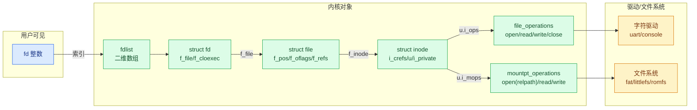

# NuttX 源码详解 06：文件系统与 VFS 层

> 涉及文件（本仓库绝对路径）：
> - `include/nuttx/fs/fs.h`（`inode` 457 行、`file` 513 行、`fd` 525 行、`fdlist` 547 行）
> - `fs/vfs/fs_open.c`（492 行）：`file_vopen()` / `nx_vopen()` / `open()`
> - `fs/vfs/fs_read.c`（420 行）：`file_readv()` / `read()`
> - `fs/vfs/fs_write.c`（467 行）：`file_writev()` / `write()`
> - `fs/vfs/fs_close.c`（233 行）：`file_close()` / `close()`
> - `fs/inode/fs_files.c`（982 行）：`fdlist_*()`
> - `fs/inode/fs_inodereserve.c`（`inode_reserve()`）
> - `fs/inode/fs_inodefind.c`（`inode_find()`）
> - `fs/driver/fs_registerdriver.c`（134 行）：`register_driver()`
> - `fs/mount/fs_mount.c`（`nx_mount()`）
> - `fs/fs_initialize.c`（`fs_initialize()`）

---

## 1. 三层模型：inode / file / fd

NuttX 的 VFS 把"文件"拆成三层，和 Linux 的 `inode/dentry/file` 类似但更轻：

| 层 | 结构 | 生命周期 | 数量 | 关键字段 |
|---|---|---|---|---|
| 路径层 | `struct inode` | 从注册/挂载到卸载 | 每个路径节点一个 | `i_parent/i_peer/i_child`、`u.i_ops`/`u.i_mops`、`i_crefs` |
| 打开层 | `struct file` | 每次 `open()` 一个 | 每个打开实例一个 | `f_oflags`、`f_pos`、`f_refs`、`f_inode` |
| 描述符层 | `struct fd` | 每次 `dup()` 一个 | 每个 fd 槽一个 | `f_file`、`f_cloexec` |

```c
struct inode
{
  FAR struct inode *i_parent;   /* Link to parent level inode */
  FAR struct inode *i_peer;     /* Link to same level inode */
  FAR struct inode *i_child;    /* Link to lower level inode */
  atomic_t          i_crefs;    /* References to inode */
  uint16_t          i_flags;    /* Flags for inode */
  union inode_ops_u u;          /* Inode operations */
  ino_t             i_ino;      /* Inode serial number */
  size_t            i_size;     /* The size of per inode driver */
...
  FAR void         *i_private;  /* Per inode driver private data */
  char              i_name[1];  /* Name of inode (variable) */
};
```

（`include/nuttx/fs/fs.h:457-477`）

`i_name[1]` 是柔性数组，实际分配用 `FSNODE_SIZE(n)`：

```c
#define FSNODE_SIZE(n) (sizeof(struct inode) + (n))
```

（`fs.h:479`）

### 1.1 `u` 是联合体，不是多态

```c
union inode_ops_u
{
  FAR const struct file_operations     *i_ops;    /* Driver operations for inode */
#ifndef CONFIG_DISABLE_MOUNTPOINT
  FAR const struct block_operations    *i_bops;   /* Block driver operations */
  FAR struct mtd_dev_s                 *i_mtd;    /* MTD device driver */
  FAR const struct mountpt_operations  *i_mops;   /* Operations on a mountpoint */
#endif
...
};
```

（`fs.h:436-453`）

同一个 inode 在任一时刻只能是其中一种：字符设备（`i_ops`）、块设备
（`i_bops`）、MTD（`i_mtd`）、挂载点（`i_mops`）、命名信号量（`i_nsem`）。

## 2. `struct file` 与 `struct fd`

```c
struct file
{
  int               f_oflags;   /* Open mode flags */
  atomic_t          f_refs;     /* Reference count */
  off_t             f_pos;      /* File position */
  FAR struct inode *f_inode;    /* Driver or file system interface */
  FAR void         *f_priv;     /* Per file driver private data */
#if CONFIG_FS_LOCK_BUCKET_SIZE > 0
  bool              f_locked;   /* Filelock state: false - unlocked, true - locked */
#endif
};

struct fd
{
  FAR struct file  *f_file;      /* The file associated with descriptor */
  bool              f_cloexec;   /* Close on exec */
...
};
```

（`fs.h:513-538`，节选）

`f_refs` 与 `i_crefs` 的区别：

- `i_crefs`：有多少个 `struct file` 指向这个 inode；
- `f_refs`：有多少个 `struct fd`（或 `dup` 出来的 fd）指向这个 `struct file`。

`close(fd)` 减少 `f_refs`；只有 `f_refs == 0` 才调 `file_close()`，
再减少 `i_crefs`；`i_crefs == 0` 才释放 inode（驱动可能在 `i_ops->close`
里做最后一次硬件关闭）。

## 3. `open()` 全路径

### 3.1 入口

```c
int open(FAR const char *path, int oflags, ...)
{
  va_list ap;
  int fd;

  /* open() is a cancellation point */

  enter_cancellation_point();

  /* Let nx_vopen() do most of the work */

  va_start(ap, oflags);
  fd = nx_vopen(nxsched_get_fdlist_from_tcb(this_task()), path, oflags, ap);
  va_end(ap);

  /* Set the errno value if any errors were reported by nx_open() */

  if (fd < 0)
    {
      set_errno(-fd);
      fd = ERROR;
    }

  leave_cancellation_point();
  return fd;
}
```

（`fs/vfs/fs_open.c:467-492`）

`open()` 是**取消点**：阻塞在 `open` 里时收到信号会返回 `EINTR`。
内部函数 `nx_open()` 不是取消点，也不改 `errno`。

### 3.2 `nx_vopen()`：分配 file + fd

```c
static int nx_vopen(FAR struct fdlist *list,
                    FAR const char *path, int oflags, va_list ap)
{
  FAR struct file *filep;
  int ret;
  int fd;

  filep = file_allocate();
  if (filep == NULL)
    {
      return -ENOMEM;
    }

  ret = file_vopen(filep, path, oflags, getumask(), ap);
  if (ret < 0)
    {
      file_deallocate(filep);
      return ret;
    }

  fd = fdlist_dupfile(list, oflags, 0, filep);
  if (fd < 0)
    {
      file_close(filep);
      file_deallocate(filep);
    }

  return fd;
}
```

（`fs_open.c:307-335`）

顺序：先 `file_allocate()` 拿一个 `struct file`，再 `file_vopen()` 解析路径
并打开驱动/文件系统，最后 `fdlist_dupfile()` 在 fd 表里找空槽。
失败时反向释放，保证没有半开状态。

### 3.3 `file_vopen()`：路径解析与分发

```c
static int file_vopen(FAR struct file *filep, FAR const char *path,
                      int oflags, mode_t umask, va_list ap)
{
  struct inode_search_s desc;
  FAR struct inode *inode;
...
  /* Get an inode for this file */

  ret = inode_search_setup(&desc, path, (oflags & O_NOFOLLOW) != 0);
  if (ret < 0)
    {
      return ret;
    }

  ret = inode_find(&desc, &inode);
  if (ret < 0)
    {
#ifdef CONFIG_PSEUDOFS_FILE
      if ((oflags & O_CREAT) != 0)
        {
          ret = pseudofile_create(&inode, path, mode);
        }
#endif
...
    }
```

（`fs_open.c:74-128`，节选）

`inode_find()` 会沿 `i_child`/`i_peer` 走路径，遇到挂载点就切换文件系统。
之后根据 inode 类型分发：

```c
  if (oflags & O_DIRECTORY)
    {
      ret = dir_allocate(filep, desc.relpath);
    }
#ifndef CONFIG_DISABLE_MOUNTPOINT
  else if (INODE_IS_MOUNTPT(inode))
    {
      if (inode->u.i_mops->open != NULL)
        {
          ret = inode->u.i_mops->open(filep, desc.relpath, oflags, mode);
        }
    }
#endif
  else if (INODE_IS_DRIVER(inode) || INODE_IS_PIPE(inode))
    {
      if (inode->u.i_ops->open != NULL)
        {
          ret = inode->u.i_ops->open(filep);
        }
    }
  else
    {
      ret = -ENXIO;
    }
```

（`fs_open.c:232-255`）

**关键差异**：挂载点的 `open` 多两个参数 `relpath` 和 `mode`，
因为文件系统需要知道"卷内相对路径"；驱动的 `open(filep)` 不需要路径，
因为设备节点本身就是路径。这也是 `mountpt_operations` 与
`file_operations` 唯一不兼容的地方（见 `fs.h:283-301` 的注释）。

### 3.4 fd 分配：两层数组

```c
int fdlist_dupfile(FAR struct fdlist *list, int oflags, int minfd,
                   FAR struct file *filep)
{
...
  i = minfd / CONFIG_NFILE_DESCRIPTORS_PER_BLOCK;
  j = minfd % CONFIG_NFILE_DESCRIPTORS_PER_BLOCK;

  /* Find free file descriptor */

  flags = spin_lock_irqsave_notrace(&list->fl_lock);

  for (; ; i++, j = 0)
    {
      if (i >= list->fl_rows)
        {
          spin_unlock_irqrestore_notrace(&list->fl_lock, flags);

          ret = fdlist_extend(list, i + 1);
          if (ret < 0)
            {
              return ret;
            }

          flags = spin_lock_irqsave_notrace(&list->fl_lock);
        }

      do
        {
          fdp = &list->fl_fds[i][j];
          if (fdp->f_file == NULL)
            {
              atomic_add(&filep->f_refs, 1);
              fdp->f_file        = filep;
              fdp->f_cloexec     = !!(oflags & O_CLOEXEC);
...
              goto found;
            }
        }
      while (++j < CONFIG_NFILE_DESCRIPTORS_PER_BLOCK);
    }

found:
  spin_unlock_irqrestore_notrace(&list->fl_lock, flags);
...
  return i * CONFIG_NFILE_DESCRIPTORS_PER_BLOCK + j;
```

（`fs/inode/fs_files.c:566-632`，节选）

fd 是"二维数组的行列索引"：

```text
fd = row * CONFIG_NFILE_DESCRIPTORS_PER_BLOCK + col
```

`fdlist` 结构（`fs.h:547`）还带一小块预分配 `fl_prefds[]`，
避免创建线程时为了 fd 0/1/2 去访问堆——这是功能安全场景的优化。

## 4. `read()` / `write()`

### 4.1 读路径

```c
ssize_t file_readv(FAR struct file *filep,
                   FAR const struct iovec *iov, int iovcnt)
{
  FAR struct inode *inode;
  ssize_t ret;

  DEBUGASSERT(filep);
  inode = filep->f_inode;
...
  ret = -EBADF;

  /* Was this file opened for read access? */

  if ((filep->f_oflags & O_ACCMODE) == O_WRONLY)
    {
      /* No.. File is not read-able */

      ret = -EACCES;
    }

  /* Is a driver or mountpoint registered? If so, does it support the read
   * method?
   * If yes, then let it perform the read.  NOTE that for the case of the
   * mountpoint, we depend on the read methods being identical in
   * signature and position in the operations vtable.
   */

  else if (inode != NULL && inode->u.i_ops)
    {
...
      if (inode->u.i_ops->readv)
        {
          struct uio uio;

          ret = uio_init(&uio, iov, iovcnt);
          if (ret == 0)
            {
              ret = inode->u.i_ops->readv(filep, &uio);
            }
        }
```

（`fs/vfs/fs_read.c:158-230`，节选）

`readv` 优先；没有 `readv` 就退回 `file_readv_compat()` 逐段调 `read`
（`fs_read.c:73-130`）。`struct uio` 是"向量 I/O 游标"，记录当前段、
段内偏移、剩余字节，避免驱动自己处理 `iovec` 数组。

### 4.2 写路径

```c
ssize_t file_writev(FAR struct file *filep,
                    FAR const struct iovec *iov, int iovcnt)
{
  FAR struct inode *inode;
  ssize_t ret;

  /* Was this file opened for write access? */

  if ((filep->f_oflags & O_ACCMODE) == O_RDONLY)
    {
      return -EACCES;
    }
...
  ret = -EBADF;
  inode = filep->f_inode;
  if (inode != NULL && inode->u.i_ops)
    {
...
      if (inode->u.i_ops->writev)
        {
          struct uio uio;

          ret = uio_init(&uio, iov, iovcnt);
          if (ret == 0)
            {
              ret = inode->u.i_ops->writev(filep, &uio);
            }
        }
      else if (inode->u.i_ops->write)
        {
          ret = file_writev_compat(filep, iov, iovcnt);
        }
```

（`fs/vfs/fs_write.c:148-208`，节选）

## 5. `close()` 与引用计数

```c
int file_close(FAR struct file *filep)
{
  struct inode *inode;
...
  inode = filep->f_inode;
...
  /* Check if the struct file is open (i.e., assigned an inode) */

  if (inode)
    {
      file_closelk(filep);

      /* Close the file, driver, or mountpoint. */

      if (inode->u.i_ops && inode->u.i_ops->close)
        {
...
          /* Perform the close operation */

          ret = inode->u.i_ops->close(filep);
...
        }

      /* And release the inode */

      if (ret >= 0)
        {
...
          inode_release(inode);
        }
...
      filep->f_inode = NULL;
    }

  return ret;
}
```

（`fs/vfs/fs_close.c:94-160`）

`close()` 的完整顺序（`fs/vfs/fs_close.c` 后半 + `fs/inode/fs_files.c`）：

1. `fdlist_close()` 清 fd 槽；
2. `file_put()` 减 `f_refs`；
3. `f_refs == 0` → `file_close()` → `i_ops->close()`；
4. `inode_release()` 减 `i_crefs`；
5. `i_crefs == 0` → 释放 inode（或交给延迟回收）。

## 6. 挂载：`nx_mount()`

`nx_mount()`（`fs/mount/fs_mount.c:293`）先找文件系统类型：

```c
  if (source != NULL && source[0] != '\0' &&
      find_blockdriver(source, mountflags, &drvr_inode) >= 0)
    {
      /* Find the block based file system */

#ifdef BDFS_SUPPORT
      mops = mount_findfs(g_bdfsmap, filesystemtype);
#endif /* BDFS_SUPPORT */
      if (mops == NULL)
        {
          ferr("ERROR: Failed to find block based file system %s\n",
               filesystemtype);

          ret = -ENODEV;
          goto errout_with_inode;
        }
    }
```

（`fs_mount.c:307-321`）

然后：

1. `inode_reserve(target, ...)` 在目标路径创建一个占位 inode；
2. `mops->bind(blkdriver, data, &handle)` 让文件系统打开卷；
3. `INODE_SET_MOUNTPT(inode)`、`inode->u.i_mops = mops`、
   `inode->i_private = handle`。

挂载点之后，路径解析到该 inode 时，`relpath` 是卷内相对路径，
VFS 把 `(filep, relpath, ...)` 传给 `i_mops`。




## 7. 陷阱与读码建议

- **`file_operations` 与 `mountpt_operations` 必须"签名和位置一致"**：
  `read/write/seek/ioctl/mmap/truncate/poll/readv/writev` 在两套结构里
  偏移相同，VFS 才能把 `i_ops` 和 `i_mops` 当联合体用（`fs.h:227-246`）。
- **`open()` 是取消点，`nx_open()` 不是**：驱动内部调 `nx_open()`，
  应用调 `open()`；混用会导致 `errno` 语义错。
- **`i_crefs` 不是打开计数**：多个 `fd` 可以指向同一个 `struct file`，
  多个 `struct file` 才增加 `i_crefs`。
- **块设备会递归**：`file_vopen()` 遇到 `INODE_IS_BLOCK`/`INODE_IS_MTD`
  会调 `block_proxy()` 创建一个临时字符驱动再 `open`（`fs_open.c:162-185`），
  栈深度多一层。
- **挂载点的 `relpath` 不含前导 `/`**：文件系统实现里拼路径时要注意。
- **`O_CLOEXEC` 存在 `fd->f_cloexec`，不在 `file->f_oflags`**：
  `fdlist_copy()` 复制时按 `cloexec` 参数决定是否跳过。
- **读码顺序**：`fs.h` 的 inode/file/fd → `fs_open.c` 的 `file_vopen()`
  → `fs_files.c` 的 `fdlist_dupfile()` → `fs_read.c`/`fs_write.c`
  → `fs_close.c` → `fs_mount.c`。配套 KB：
  [vfs.md](../../../05-学习笔记与知识库/Knowledge-Base/nuttx/vfs.md)。
