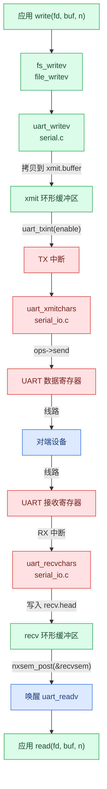
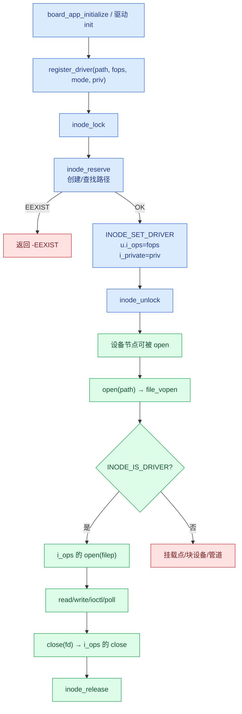
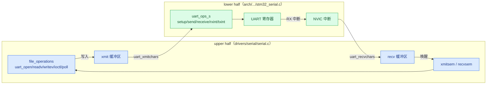

# NuttX 源码详解 07：驱动框架与移植指南

> 涉及文件（本仓库绝对路径）：
> - `fs/driver/fs_registerdriver.c`（134 行）：`register_driver()`
> - `fs/inode/fs_inodereserve.c`：`inode_reserve()`
> - `include/nuttx/fs/fs.h`（`file_operations` 221 行、`mountpt_operations` 288 行）
> - `drivers/serial/serial.c`（2570 行）：串口 **upper half**
> - `drivers/serial/serial_io.c`（347 行）：`uart_xmitchars()` / `uart_recvchars()`
> - `include/nuttx/serial/serial.h`（`uart_ops_s` 168 行、`uart_dev_s` 380 行）
> - `arch/arm/src/stm32h7/stm32_serial.c`：串口 **lower half**（`g_uart_ops` 在 731 行）
> - `boards/arm/stm32h7/nucleo-h743zi/src/stm32_boot.c`：`stm32_boardinitialize()`
> - `boards/arm/stm32h7/nucleo-h743zi/configs/nsh/defconfig`：板级配置样例
> - `drivers/drivers_initialize.c`（`drivers_initialize()` 在 117 行）

---

## 1. 驱动注册：NuttX 没有 major/minor

Linux 用 `(major, minor)` 在 `/dev` 下找设备；NuttX 直接**把设备节点插进
伪文件系统树**。`register_driver(path, fops, mode, priv)` 就是全部入口。

```c
int register_driver_with_size(FAR const char *path,
                              FAR const struct file_operations *fops,
                              mode_t mode, FAR void *priv, size_t size)
{
  FAR struct inode *node;
  int               ret;

  sched_note_mark(NOTE_TAG_DRIVERS, path);

  /* Insert a dummy node -- we need to hold the inode semaphore because we
   * will have a momentarily bad structure.
   */

  inode_lock();
  ret = inode_reserve(path, mode, &node);
  if (ret >= 0)
    {
      /* We have it, now populate it with driver specific information.
       * NOTE that the initial reference count on the new inode is zero.
       */

      INODE_SET_DRIVER(node);

      node->u.i_ops   = fops;
      node->i_private = priv;
      node->i_size    = size;

      inode_unlock();
...
      return OK;
    }

  inode_unlock();
  return ret;
}
```

（`fs/driver/fs_registerdriver.c:67-104`）

`register_driver()` 只是 `size=0` 的包装（129-133 行）。
`inode_reserve()`（`fs/inode/fs_inodereserve.c:190`）沿路径创建缺失的中间节点，
若已存在则返回 `-EEXIST`。**同一个路径只能注册一次**，重复注册要么先
`unregister_driver()`，要么改路径。

### 1.1 注册后 inode 长什么样

| 字段 | 值 | 说明 |
|---|---|---|
| `i_flags` | `INODE_IS_DRIVER` | 类型位，决定 `file_vopen()` 走 `i_ops` |
| `u.i_ops` | 指向静态 `file_operations` | 通常放在驱动源文件里，const |
| `i_private` | 驱动私有结构（如 `uart_dev_t *`） | `open` 时取回 |
| `i_crefs` | 0 | 注册本身不增加引用 |
| `i_name` | 路径最后一段 | 由 `inode_reserve()` 复制 |

## 2. `file_operations`：驱动的 11 个入口

```c
struct file_operations
{
  /* The device driver open method differs from the mountpoint open method */

  CODE int     (*open)(FAR struct file *filep);

  /* The following methods must be identical in signature and position
   * because the struct file_operations and struct mountpt_operations are
   * treated like unions.
   */

  CODE int     (*close)(FAR struct file *filep);
  CODE ssize_t (*read)(FAR struct file *filep, FAR char *buffer,
                       size_t buflen);
  CODE ssize_t (*write)(FAR struct file *filep, FAR const char *buffer,
                        size_t buflen);
  CODE off_t   (*seek)(FAR struct file *filep, off_t offset, int whence);
  CODE int     (*ioctl)(FAR struct file *filep, int cmd, unsigned long arg);
  CODE int     (*mmap)(FAR struct file *filep,
                       FAR struct mm_map_entry_s *map);
  CODE int     (*truncate)(FAR struct file *filep, off_t length);

  CODE int     (*poll)(FAR struct file *filep, FAR struct pollfd *fds,
                       bool setup);
  CODE ssize_t (*readv)(FAR struct file *filep, FAR struct uio *uio);
  CODE ssize_t (*writev)(FAR struct file *filep, FAR struct uio *uio);
...
};
```

（`include/nuttx/fs/fs.h:221-253`）

**可以只实现一部分**：`open/close` 为 `NULL` 时 VFS 直接跳过；
`read/write` 为 `NULL` 时 `read()/write()` 返回 `-EBADF` 或 `-EACCES`；
`poll` 为 `NULL` 时 `poll()` 返回 `POLLERR`（取决于 VFS 实现）。

## 3. upper/lower half：以串口为例

NuttX 的串口是理解"驱动分层"的最好样本：

| 层 | 文件 | 职责 | 不知道什么 |
|---|---|---|---|
| upper half | `drivers/serial/serial.c` | 环形缓冲区、阻塞/唤醒、termios、poll、信号字符 | 不知道寄存器地址 |
| lower half | `arch/arm/src/stm32h7/stm32_serial.c` | 寄存器读写、中断使能、DMA、波特率计算 | 不知道 fd、不知道阻塞队列 |

两层通过 `struct uart_ops_s`（`include/nuttx/serial/serial.h:168`）对接。

### 3.1 upper half 的操作表

```c
static const struct file_operations g_serialops =
{
  uart_open,    /* open */
  uart_close,   /* close */
  NULL,         /* read */
  NULL,         /* write */
  NULL,         /* seek */
  uart_ioctl,   /* ioctl */
  NULL,         /* mmap */
  NULL,         /* truncate */
  uart_poll,    /* poll */
  uart_readv,   /* readv */
  uart_writev   /* writev */
#ifndef CONFIG_DISABLE_PSEUDOFS_OPERATIONS
  , uart_unlink /* unlink */
#endif
};
```

（`drivers/serial/serial.c:169-185`）

注意 `read`/`write` 是 `NULL`，只提供 `readv`/`writev`。
VFS 的 `file_readv()` 优先调 `readv`，所以串口走的是向量路径；
`read()` 会被 `nx_readv()` 包装成一个 `iovec` 再进来。

### 3.2 注册一个串口

```c
int uart_register(FAR const char *path, FAR uart_dev_t *dev)
{
...
  /* If this UART is a serial console */

  if (dev->isconsole)
    {
      /* Enable signals and echo by default */

      dev->tc_lflag |= ISIG | ECHO | ICANON;

      /* Enable \n -> \r\n translation for the console */

      dev->tc_oflag = OPOST | ONLCR;

      /* Convert CR to LF by default for console */

      dev->tc_iflag |= ICRNL;

      /* Clear escape counter */

      dev->escape = 0;
    }

  /* Initialize mutex & semaphores */

  nxmutex_init(&dev->xmit.lock);
  nxmutex_init(&dev->recv.lock);
  nxmutex_init(&dev->closelock);
  nxsem_init(&dev->xmitsem, 0, 0);
  nxsem_init(&dev->recvsem, 0, 0);
...
  sinfo("Registering %s\n", path);
  return register_driver(path, &g_serialops, 0600, dev);
}
```

（`drivers/serial/serial.c:2306-2364`）

`dev->ops` 由 lower half 在 `uart_dev_s` 初始化时填好（`serial.h:380`）：

```c
  FAR const struct uart_ops_s *ops;  /* Arch-specific operations */
  FAR void                    *priv; /* Used by the arch-specific logic */
```

### 3.3 lower half 的操作表

`arch/arm/src/stm32h7/stm32_serial.c:731` 的 `g_uart_ops`：

```c
static const struct uart_ops_s g_uart_ops =
{
  .setup          = up_setup,
  .shutdown       = up_shutdown,
  .attach         = up_attach,
  .detach         = up_detach,
  .ioctl          = up_ioctl,
  .receive        = up_receive,
  .rxint          = up_rxint,
  .rxavailable    = up_rxavailable,
#ifdef CONFIG_SERIAL_IFLOWCONTROL
  .rxflowcontrol  = up_rxflowcontrol,
#endif
  .send           = up_send,
  .txint          = up_txint,
  .txready        = up_txready,
  .txempty        = up_txready,
};
```

移植一个新芯片，本质上就是实现这张表：

| 方法 | 何时被 upper half 调用 | 实现要点 |
|---|---|---|
| `setup` | 第一次 `open()` | 配时钟、GPIO、波特率、FIFO |
| `shutdown` | 最后一次 `close()` | 关中断、关时钟 |
| `attach` | `open()` 时 | `irq_attach()` + `up_enable_irq()` |
| `detach` | `close()` 时 | `up_disable_irq()` + `irq_detach()` |
| `ioctl` | `TCGETS/TCSETS/TIOCSBRK` 等 | 返回 `-ENOTTY` 表示不支持 |
| `receive` | 中断里 | 读一个字节，返回状态位 |
| `rxint` | 缓冲区水位变化 | 开/关 RX 中断 |
| `rxavailable` | 中断里 | 读状态寄存器 |
| `send` | `uart_xmitchars()` | 写一个字节到 DR |
| `txint` | 缓冲区空/满 | 开/关 TX 中断 |
| `txready` | `uart_xmitchars()` | 发送寄存器空？ |
| `txempty` | `close()`/`tcdrain()` | FIFO 全空？ |

### 3.4 中断下半段：`uart_xmitchars()` / `uart_recvchars()`

```c
void uart_xmitchars(FAR uart_dev_t *dev)
{
...
  while ((head = dev->xmit.head) != dev->xmit.tail && uart_txready(dev))
    {
      /* Send the next byte */

      if (dev->ops->sendbuf)
        {
          ssize_t sent;

          if (dev->xmit.tail < head)
            {
              sent = head - dev->xmit.tail;
            }
          else
            {
              sent = dev->xmit.size - dev->xmit.tail;
            }

          sent = uart_sendbuf(dev,
                              &dev->xmit.buffer[dev->xmit.tail],
                              sent);
          if (sent > 0)
            {
              dev->xmit.tail += sent;
              nbytes += sent;
            }
        }
      else
        {
          uart_send(dev, dev->xmit.buffer[dev->xmit.tail++]);
          nbytes++;
        }

      /* Increment the tail index */

      if (dev->xmit.tail >= dev->xmit.size)
        {
          dev->xmit.tail = 0;
        }
    }
```

（`drivers/serial/serial_io.c:57-124`，节选）

`xmit.head` 由线程上下文推进，`xmit.tail` 由中断推进，两者之间是生产者/消费者
关系；没有锁，只靠"head 只会增大、tail 只会增大"和环形缓冲区的空/满判断。
`recv` 方向相反：中断写 `head`，`uart_readv()` 读 `tail`。

### 3.5 数据流



## 4. 板级移植：从 defconfig 到 `board_initialize`

以 `nucleo-h743zi` 为例，一个最小移植需要：

| 文件 | 作用 | 必须改什么 |
|---|---|---|
| `boards/arm/stm32h7/nucleo-h743zi/configs/nsh/defconfig` | 配置 | `CONFIG_ARCH_BOARD`、`CONFIG_ARCH_CHIP_STM32H743ZI`、时钟、控制台 |
| `boards/.../src/stm32_boot.c` | 板级初始化 | `stm32_boardinitialize()` 里配 GPIO、LED、SPI CS |
| `boards/.../include/board.h` | 引脚/时钟宏 | `STM32_CPUCLK_FREQUENCY`、`BOARD_*` |
| `boards/.../src/stm32_appinit.c` | 应用初始化 | `board_app_initialize()` 注册设备 |
| `arch/arm/src/stm32h7/stm32_serial.c` | lower half | `g_uart_ops`、`uart_register()` |
| `arch/arm/src/stm32h7/stm32_start.c` | 启动 | 时钟、`stm32_boardinitialize()` |

`defconfig` 关键项：

```text
CONFIG_ARCH_BOARD="nucleo-h743zi"
CONFIG_ARCH_BOARD_NUCLEO_H743ZI=y
CONFIG_ARCH_CHIP="stm32h7"
CONFIG_ARCH_CHIP_STM32=y
CONFIG_ARCH_CHIP_STM32H743ZI=y
CONFIG_ARCH_CHIP_STM32H7=y
CONFIG_ARCH_CHIP_STM32H7_CORTEXM7=y
```

（`boards/arm/stm32h7/nucleo-h743zi/configs/nsh/defconfig:12-18`）

### 4.1 注册顺序

1. `__start` → `stm32_boardinitialize()`：只配 GPIO/时钟，**不要**在这里
   `register_driver()`，因为 VFS 还没初始化；
2. `nx_start()` → `up_initialize()` → `arm_serialinit()`：串口驱动初始化；
3. `nx_start()` → `drivers_initialize()`：公共设备（null/zero/random）；
4. `nx_start()` → `board_early_initialize()`：板级早期设备；
5. `nx_bringup()` → `board_late_initialize()`（如果配置）：文件系统、网络。

在 `up_initialize()` 之前注册驱动会失败，因为 `inode_reserve()` 依赖
`fs_initialize()` 建好的根 inode。

## 5. 驱动注册全景





## 6. 移植清单（以新 UART 为例）

| 步骤 | 检查项 | 常见错误 |
|---:|---|---|
| 1 | 在 `arch/arm/src/<chip>/Kconfig` 加芯片选项 | 忘记 `select ARCH_HAVE_SERIAL` |
| 2 | 在 `Make.defs` 加 `CHIP_CSRCS += xxx_serial.c` | 文件没编进去，链接时才报 undefined |
| 3 | 实现 `struct uart_ops_s` 全部必需方法 | `txready`/`rxavailable` 写成阻塞 |
| 4 | 填 `uart_dev_s` 的 `xmit/recv` 缓冲区与 `ops` | 缓冲区大小不是 2 的幂也能跑，但取模开销大 |
| 5 | 在 `up_initialize()` 或 `arm_serialinit()` 调 `uart_register()` | 在 `nx_start()` 之前注册 |
| 6 | 在 `board.h` 定义 `BOARD_UART*` 引脚 | 引脚复用没配 |
| 7 | 用 `CONFIG_SERIAL_TERMIOS` 验证 `tcgetattr/tcsetattr` | `VMIN/VTIME` 语义没实现 |
| 8 | 用 `CONFIG_SERIAL_RXDMA/TXDMA` 验证 DMA 路径 | `dmasend`/`dmareceive` 没清中断 |

## 7. 陷阱与读码建议

- **`register_driver()` 不是线程安全的重复注册**：`inode_reserve()` 持
  `inode_lock()`，但两次注册同一路径第二次必失败；驱动 init 要保证只跑一次。
- **`i_private` 的生命周期由驱动负责**：VFS 不会 free 它；`unregister_driver()`
  只删 inode，不释放 `priv`。
- **`open` 可能被调用多次**：每个 `open()` 都会调 `i_ops->open`，
  驱动要用 `open_count` 判断"第一次"才做硬件初始化（`serial.c:858`）。
- **中断里不能 `kmm_malloc`**：`uart_recvchars()` 只写环形缓冲区、
  `nxsem_post()`；任何分配都要推到 work queue。
- **`sendbuf` 不是必需的**：没有它就用逐字节 `send()`；有它时要注意
  环形缓冲区跨界，`sent` 不能超过 `size - tail`。
- **`uart_register()` 的 mode 是 0600**：普通用户打不开 `/dev/ttyS0`，
  需要 `CONFIG_FS_*` 权限或改 mode。
- **读码顺序**：`fs.h` 的 `file_operations` → `fs_registerdriver.c` →
  `serial.h` 的 `uart_ops_s`/`uart_dev_s` → `serial.c` 的 `uart_register()`
  → `serial_io.c` 的 `uart_xmitchars()`/`uart_recvchars()` →
  `stm32_serial.c` 的 `g_uart_ops`。配套 KB：
  [vfs.md](../../../05-学习笔记与知识库/Knowledge-Base/nuttx/vfs.md)。
